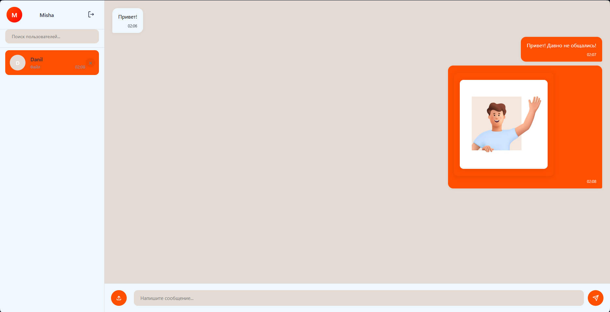
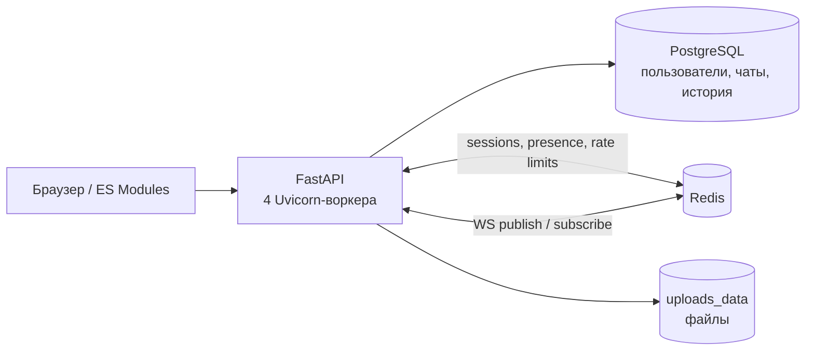

# ITMessage — Realtime Messenger

Мессенджер 1-на-1 на **FastAPI + PostgreSQL + Redis + WebSocket** с браузерным интерфейсом на нативных JavaScript ES Modules. Авторизация — JWT RS256 в HttpOnly cookies, отзыв/ротация сессий через Redis, CSRF-защита и загрузка вложений. Production-конфигурация использует **четыре Uvicorn-воркера** с Redis Pub/Sub для межпроцессных событий.




## Возможности

- Регистрация, вход, выход, JWT access/refresh, отзыв сессий и CSRF Double Submit Cookie.
- Личные чаты, история сообщений, optimistic UI и подтверждение по `client_id`.
- Real-time обновления через WebSocket; Redis Pub/Sub соединяет вкладки на разных воркерах.
- Глобальный online/offline через Redis с отдельной арендой и TTL на каждую вкладку; время последнего посещения.
- Вложения с ограничениями размера и типов, обработка изображений через Pillow; файлы за пределами публичной статики.
- Общие для всех процессов Redis rate limits; защита WebSocket Origin и настраиваемые доверенные reverse proxy.
- Тесты PostgreSQL-миграций, Redis между процессами и полного Docker Compose запуска.

## Быстрый старт

Нужны Docker Engine с Compose и OpenSSL. Используйте **один корневой `.env`**.

```bash
git clone https://github.com/ITouch228/fastapi-realtime-messenger.git
cd fastapi-realtime-messenger
cp .env.example .env

mkdir -p backend/keys
openssl genpkey -algorithm RSA -pkeyopt rsa_keygen_bits:2048 -out backend/keys/private.pem
openssl pkey -in backend/keys/private.pem -pubout -out backend/keys/public.pem

docker compose -f docker-compose.yml -f docker-compose.prod.yml up -d --build --wait
```

В `.env` измените `DB_PASSWORD` для реального развёртывания; `COOKIE_SECURE=false` допустим **только для локального HTTP**, а для HTTPS требуется `COOKIE_SECURE=true`. Доступ к приложению: http://localhost:8000; OpenAPI: http://localhost:8000/docs. Диагностика:

```bash
docker compose -f docker-compose.yml -f docker-compose.prod.yml ps
docker compose -f docker-compose.yml -f docker-compose.prod.yml logs --tail=100 backend
```

Docker монтирует `backend/keys` в `/app/keys:ro`; процесс работает от UID `10001` и должен иметь права на чтение PEM-файлов. **Никогда не коммитьте RSA private key или `.env`.** Пример безопасной проверки: [docs/docker-secrets.md](docs/docker-secrets.md). В Windows PowerShell вместо `cp` используйте `Copy-Item`; OpenSSL должен быть установлен и доступен в PATH.

Для разработки с автообновлением (Compose автоматически применяет `docker-compose.override.yml`) можно использовать `docker compose up --build`, но этот режим **не является production**.

### Запуск без Docker

Потребуются собственные PostgreSQL 16, Redis 7 и Python 3.12.

```bash
python -m venv .venv
# Активируйте .venv в своей оболочке
python -m pip install -r backend/requirements-dev.txt
cp .env.example .env
# Настройте DB_*, REDIS_URL, COOKIE_SECURE и RSA-ключи
cd backend
alembic upgrade head
uvicorn app.main:app --reload
```

**Важно:** в проекте одна начальная ревизия Alembic — `001_initial_schema`. Она создаёт все пять актуальных таблиц **только в новой пустой PostgreSQL**. Старые Alembic revision ID не поддерживаются: существующую локальную БД нужно сохранить отдельно (если нужны данные), затем создать новую пустую БД и выполнить `alembic upgrade head`. Нельзя применять smoke-тесты к рабочей базе: они создают тестовые аккаунты и сообщения. См. [инструкцию БД](docs/database.md).

## Архитектура



Приложение разделено на слои `routes → services → dao → models`; DTO находятся в `schemas`, обработка ошибок — в `exceptions`. Клиент: `core` (HTTP, WebSocket, store), `features` (пользовательские сценарии), `ui` (рендер). `core/csrf.js` независим от Axios, поэтому формы входа и регистрации могут работать отдельно от мессенджера.

**Источник истины — PostgreSQL.** Redis Pub/Sub доставляет события только активным подписчикам и не сохраняет события при обрыве Redis. После reconnect клиент перечитывает чаты и историю через REST. События `presence_update` упорядочиваются версиями Redis (PR #15).

Подробнее: [схемы компонентов и ER](docs/architecture.md) · [последовательности запросов](docs/data_flow.md) · [четыре воркера и ограничения](docs/ws-multiworker.md).

## API

| Категория | Методы и пути |
| --- | --- |
| Auth | `POST /api/auth/register`, `login`, `logout`, `refresh` |
| Users | `GET /api/users/me`, `/search?query=`, `/{user_id}` |
| Chats | `GET /api/chats`, `/direct/{target_id}`; `DELETE /api/chats/{chat_id}` |
| Messages | `GET /api/messages/{chat_id}`, `POST /api/messages/{chat_id}`, `DELETE /api/messages/{message_id}` |
| Files | `GET /api/files/{file_id}` |
| WebSocket | `/api/ws/{user_id}` |

Большинство HTTP API требует действительную cookie `access`; запросы изменения состояния дополнительно проверяют `X-CSRF-Token`. WebSocket проверяет Origin по `ALLOWED_ORIGINS` и действительность авторизованной сессии.

## Качество и тесты

Один [GitHub Actions workflow](.github/workflows/ci.yml) запускается для PR, push в `main` и вручную. Три параллельных задания:

| Job | Что проверяет |
| --- | --- |
| **Backend (Python 3.12)** | Ruff lint/format, mypy, unit, миграции PostgreSQL 16, интеграцию Redis и HTTP smoke |
| **Frontend (Node 22)** | ESLint, Prettier |
| **Docker Compose (4 workers)** | Production Compose, RSA в runtime, отсутствие секретов в образе, HTTP smoke, рестарт |

```bash
python -m pip install -r backend/requirements-dev.txt
npm ci
cd backend
ruff check .
ruff format --check .
mypy --package app
python -m unittest discover -s tests -p "test_*.py" -v
```

Про Docker и интеграционные проверки см. [docs/ci.md](docs/ci.md). Локальные хуки: [docs/pre-commit.md](docs/pre-commit.md).

## Документация

- [База данных и единая миграция](docs/database.md)
- [Архитектура и диаграммы](docs/architecture.md)
- [Data flow и последовательности](docs/data_flow.md)
- [CI и локальные проверки](docs/ci.md)
- [Стратегия тестирования и HTTP-контракты](docs/testing.md)
- [WebSocket и несколько воркеров](docs/ws-multiworker.md)
- [Секреты Docker](docs/docker-secrets.md)
- [История изменений](docs/CHANGELOG.md)
- [Оставшиеся задачи](docs/TODO.md)
- [Правила коммитов и PR](CONTRIBUTING.md)

## Дальнейшие задачи

Устранение гонки presence N19, надёжная очередь очистки вложений после сбоев, браузерные E2E-тесты, пагинация истории и расширение функциональности. Приоритеты поддерживаются в [TODO](docs/TODO.md); уже реализованные Redis Pub/Sub, CI и Docker smoke **не являются открытыми задачами**.

## Лицензия

Учебный pet-проект с лицензией MIT — см. [LICENSE](LICENSE).
