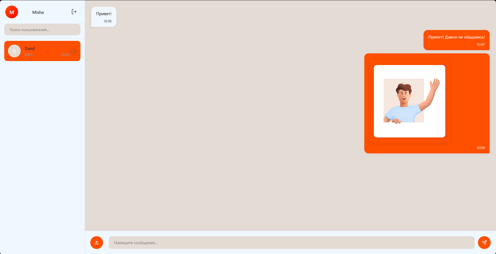

# ITMessage — Realtime Messenger

Fullstack-мессенджер 1-на-1: реалтайм-доставка через WebSocket, JWT RS256 в httpOnly-cookie с сессиями в Redis (revocation + ротация), CSRF-защита, загрузка файлов со сжатием изображений, Docker-инфраструктура.


---

## Результат

Статические проверки чистые: `ruff` — 0 ошибок, `ruff format` — 0, `mypy` — 0.

```text
✅ Ruff (lint)
✅ Ruff (format)
✅ Mypy
```



Документация проекта:
[`docs/architecture.md`](docs/architecture.md) (слои, эндпоинты, сводка проблем) ·
[`docs/data_flow.md`](docs/data_flow.md) (флоу данных) ·
[`docs/CHANGELOG.md`](docs/CHANGELOG.md) (история версий).

---

## Как это работает

Пользователь регистрируется и логинится — сервер выдаёт пару JWT (access + refresh) на асимметричном RS256 и кладёт их в httpOnly-cookies вместе с CSRF-токеном (`csrftoken`). Каждая сессия регистрируется в Redis: в `sub` токена лежит `session_id`, поэтому сессии можно отзывать, а refresh — ротировать. Фронт на vanilla JS (ES-модули) подключается к WebSocket (`/api/ws/{user_id}`, авторизация по `access`-cookie) и получает push-события о новых сообщениях и чатах. При отправке сервер сохраняет сообщение в PostgreSQL и рассылает `new_message` **всем** участникам чата (включая отправителя) с `client_id` для надёжного подтверждения оптимистичного сообщения. Файлы загружаются через `multipart/form-data` в `uploads/` (вне публичной статики), изображения сжимаются в WebP (Pillow), при отдаче адаптируются под устройство по User-Agent. Write-запросы защищены CSRF (Double Submit Cookie) и rate limiting.

---

## Быстрый старт

```bash
git clone git@github.com:ITouch228/ITMessage.git
cd ITMessage

cp .env.example .env
cp backend/.env.example backend/.env   # заполнить DB_PASSWORD, DB_NAME

docker compose up --build -d
```

- Приложение — http://localhost:8000
- API docs — http://localhost:8000/docs

> **Важно:** для RS256-токенов нужна RSA-пара в `backend/keys/` (`private.pem` + `public.pem`).
> Директория в `.gitignore` — ключи не коммитятся, каждый разработчик генерирует свою пару локально:
> ```bash
> mkdir -p backend/keys
> openssl genrsa -out backend/keys/private.pem 2048
> openssl rsa -in backend/keys/private.pem -pubout -out backend/keys/public.pem
> ```
> Без ключей приложение упадёт при старте с `FileNotFoundError: .../keys/private.pem`.

> **Локально по http:** задайте `COOKIE_SECURE=false` в `backend/.env`, иначе браузер не примет Secure-куки.

Без Docker (нужны локальные PostgreSQL и Redis):

```bash
cd backend
python -m venv .venv && .venv\Scripts\activate
pip install -r requirements.txt
cp .env.example .env   # заполнить DB_* и REDIS_URL
alembic upgrade head
uvicorn app.main:app --reload
```

---

## Стек

**Backend**
- **Python** 3.12
- **FastAPI** 0.115 + **Starlette** — async-роуты, WebSocket, middleware
- **SQLAlchemy** 2.0 (async) + **asyncpg** — ORM и драйвер PostgreSQL
- **Alembic** — миграции
- **Redis** (redis.asyncio) — сессии (revocation + ротация refresh)
- **python-jose** — JWT RS256 (access/refresh)
- **passlib + bcrypt** — хеширование паролей
- **slowapi** — rate limiting
- **Pillow** — сжатие изображений в WebP
- **aiofiles** — async файловый I/O
- **Jinja2** — серверные шаблоны страниц (только HTML-страницы)
- **Ruff** (lint + format) + **mypy** (types)

**Frontend**
- **Vanilla JS** (ES Modules) — без фреймворка и сборщика
- **Axios** — HTTP-клиент с auto-refresh интерсептором и CSRF-заголовком
- **WebSocket API** — нативный браузерный, reconnect с exponential backoff
- **CSS** — адаптивная вёрстка
- **ESLint + Prettier** — линтинг и форматирование JS

**Инфраструктура**
- **Docker** + **docker-compose** — postgres 16 + redis 7 + backend (backend отдаёт приложение напрямую на 8000, без reverse proxy)
- **Makefile** — команды разработки

---

## Архитектура

Слоистая: `routes → services → dao → models` (+ `database` для сессий). Роуты не знают про SQL, сервисы не знают про HTTP. Все ошибки — через единый слой typed-исключений.

**Backend** (`backend/app/`):
- `routes/` — HTTP-эндпоинты + WebSocket (auth, users, chats, messages, files, pages, ws)
- `services/` — бизнес-логика (auth, users, chats, messages, files, presence, session_manager, redis_client, limiter, websocket_manager)
- `dao/` — BaseDAO (Generic) + UserDAO, ChatDAO, MessageDAO, FileDAO
- `models/` — SQLAlchemy-модели (User, Chat, Message, File)
- `schemas/` — Pydantic-схемы (DTO, изоляция от БД)
- `exceptions/` — AppError + typed-ошибки и централизованные handlers
- `utils/` — logging, security, jwt, cookies, csrf, files, validators
- `static/` — JS (core/features/ui), CSS, изображения, звуки
- `templates/` — Jinja2-шаблоны страниц

**Frontend** (`static/js/`, ES-модули без сборщика):
- `app.js` — композиция (bootstrap: юзер → сокет → подписки на store)
- `core/` — инфраструктура: `store.js`, `socket.js`, `wsHandler.js`, `api.js`, `constants.js`
- `features/` — доменные сценарии: `chats.js`, `messages.js`, `send.js`, `search.js`, `auth.js`, `login.js`, `register.js`
- `ui/` — отрисовка: `messageView.js` (единый источник разметки), `imageLoader.js`, `wsStatus.js`, `lightbox.js`, `badge.js`

### Ключевые решения

- **JWT RS256 (асимметричный).** Приватный ключ подписывает на сервере, публичный проверяет. Компрометация публичного ключа не даёт подделать токен — в отличие от HS256.
- **Токены в httpOnly-cookies, не в JS-памяти.** `set_cookie(httponly=True, secure, samesite)` — XSS не украдёт токен. Фронт не хранит access/refresh в `localStorage`.
- **Сессии в Redis (revocation + ротация).** `sub` JWT = `session_id`; `SessionManager` держит пару `session_id → user_id` с TTL. Logout отзывает сессию, refresh создаёт новую и удаляет старую.
- **Auto-refresh JWT с очередью запросов.** При 401 интерсептор в `api.js` обновляет токен ровно один раз, параллельные упавшие запросы складываются в `queue` и повторяются после обновления. Отдельный `authApi`-клиент без интерсепторов исключает цикл рефреша.
- **CSRF Double Submit Cookie.** Сервер кладёт `csrftoken` (не httpOnly) и требует заголовок `X-CSRF-Token` с тем же значением на write-роутах (logout, refresh, send/delete message, delete chat).
- **Unit of Work.** `get_session` не коммитит; явный `session.commit()` только в write-эндпоинтах. GET-запросы ничего не фиксируют.
- **WebSocketManager для WebSocket.** `dict[int, list[WebSocket]]` — один пользователь может иметь несколько вкладок. `send_personal_message` итерирует по всем подключениям пользователя.
- **Валидация пути файла через resolve + startswith.** `save_file` и `resolve_file_path` проверяют, что путь начинается с `FILES_ROOT`. Сам `FILES_ROOT` (`backend/uploads`) лежит **вне** `STATIC_DIR` — файлы не отдаются публично, только через `/api/files/{id}` с проверкой доступа.
- **Dummy bcrypt-hash при отсутствии пользователя.** `authenticate_user` вызывает `verify_password` с фейковым хешем, если юзер не найден — время ответа одинаковое, user enumeration по timing невозможен.
- **Изображения: сжатие при загрузке + адаптивная отдача.** При загрузке — WebP quality 85. При отдаче — параметры `width`/`quality` с подменой по User-Agent (mobile: 800px/60, desktop: 1200px/80).
- **Rate limiting (slowapi).** Логин — 5/минуту, регистрация — 10/час.
- **Единый слой исключений.** `AppError` и наследники (`BadRequestError`, `UnauthorizedError`, `PermissionDeniedError`, `NotFoundError`, `ConflictError`, `PayloadTooLargeError`) + централизованные handlers; роуты не бросают `HTTPException`.
- **Временный чат (`temp-{peerId}`).** При первом сообщении незнакомому пользователю фронт создаёт temp-чат и передаёт `peer_id` в FormData; бэкенд создаёт реальный чат и уведомляет обе стороны через WebSocket, клиент заменяет temp-id на реальный (`store.replaceTempChat`).

### Что решалось по ходу

- **Гонка сообщений при отправке.** Без блокировки кнопки можно было отправить два сообщения с одним temp-чатом → два чата с одним получателем. Решил через `setSendingState(true/false)` + флаг `_retry` на запросах.
- **Race condition при параллельном refresh.** Без `isRefreshing` + `refreshPromise` несколько 401 вызывали несколько `/auth/refresh` → токен обновлялся несколько раз. Добавил singleton-промис.
- **Сломанный auto-refresh.** В обработчике 401 использовалась неопределённая переменная `url` (ReferenceError) — refresh не срабатывал. Исправлено на `original.url`.
- **Потеря сообщений при offline.** При открытии чата контейнер очищался до сетевого ответа, и при падении запроса уже отрисованные из стора сообщения исчезали. Теперь рендер из стора идёт сразу, обновление — только при успехе.
- **Race при ленивой инициализации Redis.** Параллельные запросы могли создать несколько ConnectionPool. Закрыл `asyncio.Lock` + double-checked locking.
- **N+1 при загрузке чата.** Чат + сообщения и сообщение + участники теперь берутся одним запросом (join/outerjoin), файлы — батчем (`FileDAO.find_by_ids`).
- **CORS не пропускал WebSocket.** `allow_origins` не покрывал `wss://` → фронт не мог подключиться. Добавил явный `https://` origin + `expose_headers`.
- **PostgreSQL `ARRAY(Integer)` для `chat.users` вместо association table.** Упрощает запросы (`.contains([user_id])`) + GIN-индекс, но требует явного упорядочивания `[min, max]` при создании чата.
- **Белый список MIME-типов и расширений.** Загрузка проверяет и `allowed_extensions`, и `ALLOWED_MIME_TYPES` — двойная защита от SVG-XSS и исполняемых файлов.
- **Удаление сообщения = soft-delete.** `UPDATE SET message_text=NULL, message_file_id=NULL, is_deleted=true` вместо `DELETE` — история чата не ломается.
- **Линтеры Python сведены с шести (black/isort/ruff/mypy/vulture/bandit) к двум** — **Ruff** (lint+format) и **mypy**; для JS — ESLint + Prettier. Один конфиг `pyproject.toml`, быстрее и меньше конфликтов.

---

## Модель данных

```text
User (id, email, username, hashed_password, is_active, is_superuser,
      last_login_at, last_seen_at, created_at, updated_at)
 └─ Chat (id, users: ARRAY[INT], created_at, updated_at)
     └─ Message (id, chat_id, sender_id, message_text,
                 message_file_id, sent_at, is_deleted, created_at, updated_at)
         └─ File (id, file_path, owner_id, original_name,
                  mime_type, size_bytes, created_at, updated_at)
```

Связь User ↔ Chat — через `ARRAY(Integer)` в PostgreSQL (+ GIN-индекс), не FK-таблица. Message → File — nullable FK (`ON DELETE SET NULL`), Message → Chat — `ON DELETE CASCADE`. `created_at`/`updated_at` наследуются из `Base`.

---

## API

Все API-роуты смонтированы под префиксом `/api`. Страницы (`/`, `/auth/login`, `/auth/register`, `/messages`) отдаются отдельно через Jinja2.

| Метод | URL | Описание |
|-------|-----|----------|
| POST | `/api/auth/register` | Регистрация (rate limit 10/hour) |
| POST | `/api/auth/login` | Логин → httpOnly-cookies access+refresh+csrftoken (5/minute) |
| POST | `/api/auth/logout` | Отзыв сессии в Redis + удаление cookies (CSRF) |
| POST | `/api/auth/refresh` | Ротация сессии: новый access/refresh (CSRF) |
| GET | `/api/users/me` | Текущий пользователь |
| GET | `/api/users/search?query=` | Поиск пользователей (ilike) |
| GET | `/api/users/{user_id}` | Информация о пользователе |
| GET | `/api/chats` | Список чатов + последнее сообщение + статус собеседника |
| GET | `/api/chats/direct/{target_id}` | Найти чат с пользователем (или `null`) |
| DELETE | `/api/chats/{chat_id}` | Удалить чат (CSRF, 204) |
| GET | `/api/messages/{chat_id}` | Сообщения чата (с file meta) |
| POST | `/api/messages/{chat_id}` | Отправить сообщение + файл (multipart, CSRF, 201) |
| DELETE | `/api/messages/{message_id}` | Soft-delete сообщения (CSRF, 204) |
| GET | `/api/files/{file_id}?width=&quality=` | Отдать файл (адаптивное изображение) |
| WS | `/api/ws/{user_id}` | WebSocket-подключение (auth по `access`-cookie) |

Все эндпоинты, кроме `/auth/*`, требуют `access`-cookie. Write-эндпоинты дополнительно требуют заголовок `X-CSRF-Token`.

### Пример отправки сообщения

```bash
POST /api/messages/1
Content-Type: multipart/form-data
X-CSRF-Token: <csrftoken из cookie>

message_text=Привет!
client_id=<uuid>          # для подтверждения оптимистичного сообщения
file=@photo.jpg
file_name=photo.jpg
peer_id=7                 # только для создания нового чата (temp-чат)
```

```json
{
  "id": 42,
  "chat_id": 1,
  "sender_id": 7,
  "message_text": "Привет!",
  "message_file_id": 12,
  "sent_at": "2026-09-28T14:30:05+00:00",
  "is_deleted": false,
  "file": {
    "id": 12,
    "kind": "image",
    "url": "/api/files/12",
    "mime_type": "image/webp",
    "filename": "photo.jpg",
    "size": 204800
  }
}
```

---

## Структура проекта

```text
backend/
    app/
        main.py              # FastAPI-приложение, lifespan, middleware, static
        config.py            # Settings + пути (BASE_DIR, STATIC_DIR, FILES_ROOT)
        database.py          # async engine, session, Base (id/created_at/updated_at)
        deps.py              # Jinja2Templates, pwd_context
        routes/              # auth, users, chats, messages, files, pages, ws
        services/            # auth, users, chats, messages, files, presence,
                             # session_manager, redis_client, limiter, websocket_manager
        dao/                 # base.py (BaseDAO) + dao.py (UserDAO, ChatDAO, ...)
        models/              # SQLAlchemy: User, Chat, Message, File
        schemas/             # Pydantic DTO: UserCreate, MessageResponse, FileResponse, ...
        exceptions/          # AppError + typed-ошибки + handlers
        utils/               # logging.py, security.py, jwt.py, cookies.py,
                             # csrf.py, files.py, validators.py
        static/              # js/ (core/features/ui), css/, images/, sounds/
        templates/           # index.html, login.html, register.html
    keys/                    # RSA-пара для RS256 (gitignored)
    uploads/                 # загруженные файлы (volume, вне статики, gitignored)
    migration/               # Alembic (env.py, versions/)
    alembic.ini
    Dockerfile
    entrypoint.sh            # alembic upgrade head + uvicorn
    requirements.txt
    requirements-dev.txt
    pyproject.toml           # ruff + mypy config
docker-compose.yml           # postgres 16 + redis 7 + backend, volumes, networks
Makefile                     # команды разработки
eslint.config.cjs            # ESLint для JS
package.json                 # ESLint + Prettier
```

---

## Команды (Makefile)

```bash
make build             # docker-compose up --build
make build-d           # то же в фоне
make up / make down    # контейнеры в фоне / остановить
make down-v            # остановить + удалить volumes
make restart           # down + up
make logs              # логи контейнеров
make migrate           # alembic upgrade head (в контейнере)

make lint-back         # ruff check + ruff format --check + mypy
make lint-front        # eslint + prettier --check
make lint              # lint-back + lint-front
make lint-fix          # автофикс: ruff --fix/format + eslint --fix + prettier --write
make format            # форматирование (backend + frontend)
make check             # format + lint
make quality           # алиас check
```

Настройки линтеров — в `backend/pyproject.toml` (Ruff + mypy) и `eslint.config.cjs` / `package.json` (ESLint + Prettier).

---

## Планы по улучшению

- **Групповые чаты** — сейчас только 1-на-1 (`users == [a, b]`), нужна таблица `chat_members`.
- **Read receipts** — отметки о прочтении через `last_read_message_id` на пользователя в чате.
- **Пагинация сообщений** — сейчас все сообщения чата грузятся одним запросом.
- **Redis Pub/Sub для WS fan-out** — сессии уже в Redis, но `WebSocketManager` пока in-process (не масштабируется на несколько инстансов).
- **Тесты** — pytest + httpx.AsyncClient, покрытие сервисного и DAO-слоя.
- **PostgreSQL full-text search** вместо `ilike` для поиска пользователей.
- **Отложенная косметика** — M1, M4–M11 и DUP1–DUP2 из `docs/architecture.md` §5.

---

## Лицензия

Учебный pet-проект. MIT. См. [LICENSE](LICENSE).
