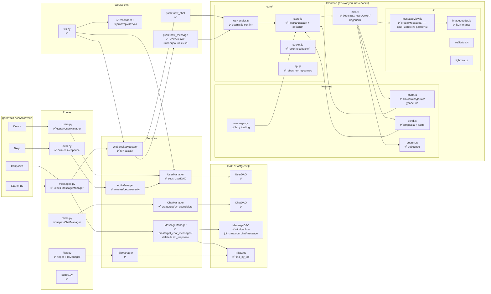
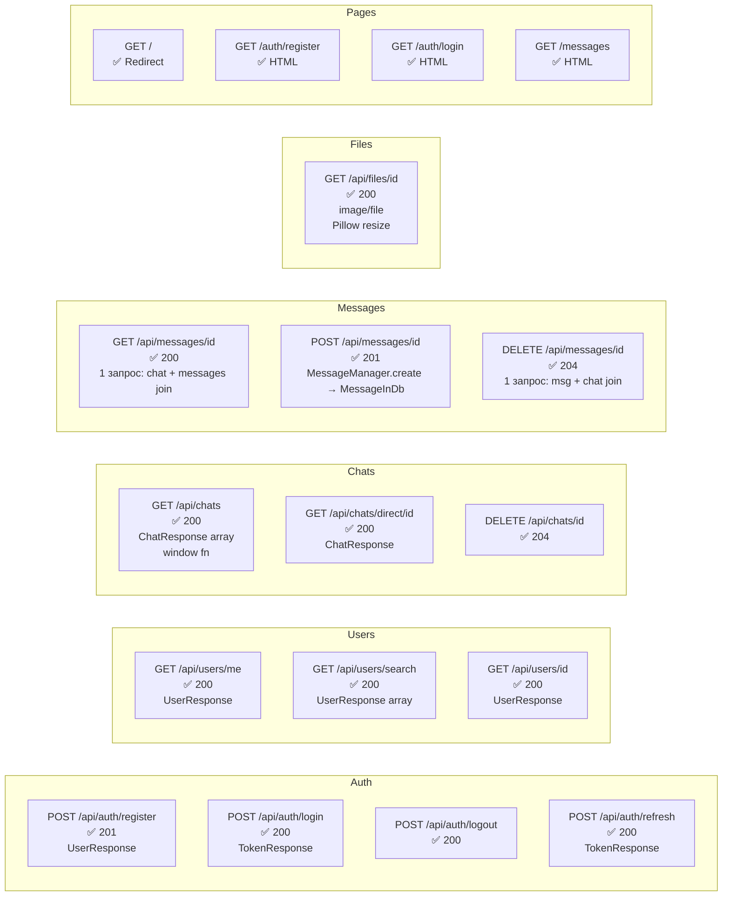
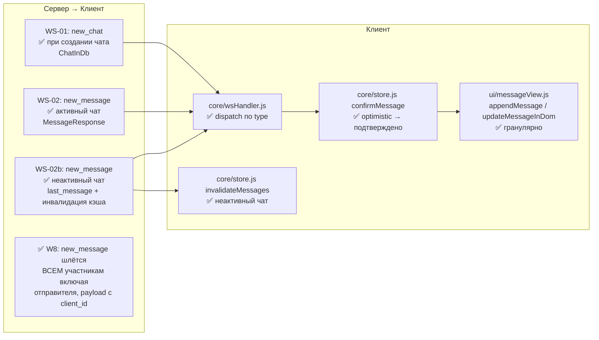
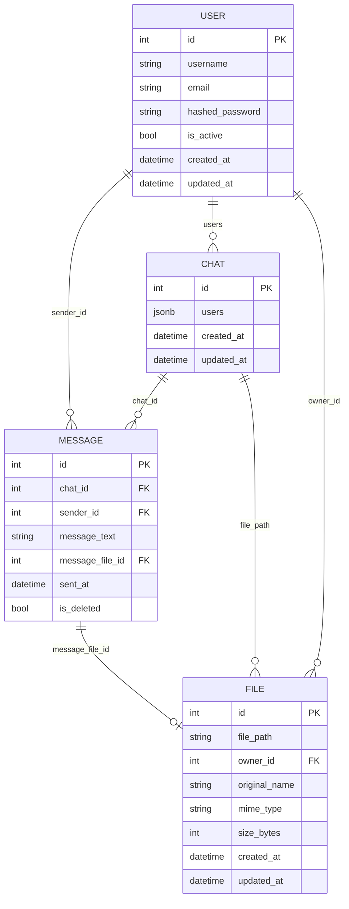

# Архитектура ITMessage

> Все эндпоинты, слои, данные.
> Открытые задачи — в [TODO.md](TODO.md). Закрытые — в [CHANGELOG.md](CHANGELOG.md).

---

> ✅ Исправлено (B2): при потере соединения сообщения, уже отрисованные из стора,
> больше не пропадают. `activeChat`-подписка рендерит стор сразу и не очищает
> контейнер до сетевого ответа; обновление приходит через `messages:replaced`
> только при успехе запроса.
>
> ✅ Исправлено (B3): в `core/api.js` в обработчике 401 использовалась
> неопределённая переменная `url` (ReferenceError) — авто-refresh был сломан.
> Заменено на `original.url`.

## 1. Архитектура системы



## 2. REST API — все эндпоинты



## 3. WebSocket события



## 4. Модель данных



---

> `routes/messages.py` (send_message). Все 10 ошибок закрыты.
> Фиксы: `chat_id_int` вместо мутации `chat_id: str`; `ChatManager.create → ChatInDb`
> + `model_dump(mode='json')` вместо `to_dict()`; `MessageManager.create → MessageInDb`
> вместо прямого `MessageDAO.add`; `file_id: int | None` в `MessageManager.create`.

```mermaid
graph LR
    subgraph ERRS["Ошибки (routes/messages.py)"]
        E1["✅ L76→80: chat_id_int = chat.id<br/>int в int-переменную"]
        E2["✅ L85→97: chat_id_int = int(chat_id)<br/>int в int-переменную"]
        E3["✅ L92→104: chat_id_int:int<br/>в get(chat_id:int)"]
        E4["✅ L118→130: save_file(chat_id_int:int)"]
        E5["✅ L126→138: FileManager.create(chat_id_int:int)"]
        E6["✅ L81→91: created_chat.model_dump(mode='json')<br/>вместо to_dict()"]
        E7["✅ chat только ChatResponse|None<br/>created_chat — отдельная переменная"]
        E8["✅ L141: file_in_db.id<br/>закрыто (create → FileInDb)"]
        E9["✅ L146→148: MessageManager.create<br/>→ MessageInDb"]
        E10["✅ file_id: int | None<br/>инициализирован до if file"]
    end
```



### Детализация и история фикса

| Строка (было → стало) | Сообщение | Корень | Статус | Как исправлено |
|------------------------|-----------|--------|--------|----------------|
| 76 → 80 | int → str (`chat_id = chat.id`) | `chat_id: str` | ✅ | `chat_id_int: int = created_chat.id` |
| 85 → 97 | int → str (`chat_id = int(chat_id)`) | `chat_id: str` | ✅ | `chat_id_int = int(chat_id)` |
| 92 → 104 | `chat_id: str` в `get(chat_id: int)` | `chat_id: str` | ✅ | `ChatManager.get(chat_id=chat_id_int)` |
| 118 → 130 | `save_file(chat_id: str)`, ожидался int | `chat_id: str` | ✅ | `save_file(chat_id_int, ...)` |
| 126 → 138 | `FileManager.create(chat_id: str)`, ожидался int | `chat_id: str` | ✅ | `FileManager.create(chat_id=chat_id_int, ...)` |
| 81 → 91 | `ChatInDb` не имеет `to_dict()` | `ChatManager.create → ChatInDb` | ✅ | `created_chat.model_dump(mode='json')` |
| 92 | `ChatResponse\|None` в переменную `ChatInDb` | смешение `create`/`get` в `chat` | ✅ | `created_chat` (ChatInDb) и `chat` (ChatResponse) — разные переменные |
| 141 | `int` не имел `id` (`file_in_db.id`) | `FileManager.create → int` | ✅ | `FileManager.create → FileInDb` |
| 146 → 148 | `Message` (ORM) вместо `MessageInDb` | `MessageDAO.add → Message` | ✅ | `MessageManager.create → MessageInDb` |
| 141 | `file_in_db` не связана при `file=None` | `file_id = None` мёртв, `file_in_db` только в `if file:` | ✅ | `file_id: int \| None = None` инициализирован до `if file` |

---

## 7. Исправлено в этой сессии (для актуальности графов)

```mermaid
graph LR
    subgraph FIXED_FE["✅ Frontend — состояние (store.js)"]
        FF1[Централизованный store.js<br/>нормализация: chats.byId/order,<br/>messages.byId по чатам, peerStatuses]
        FF2[Lazy loading сообщений<br/>1 загрузка с сервера + WS<br/>isLoaded / invalidateMessages]
        FF3[Optimistic updates<br/>addOptimisticMessage sended:false<br/>confirmMessage sended:true + real id]
        FF4[Гранулярные события<br/>messages:replaced / message:new /<br/>message:update — без полной перерисовки]
        FF5[WS неактивный чат<br/>инвалидирует кэш, история<br/>не теряется при открытии]
        FF6[temp-чат → реальный id<br/>store.replaceTempChat чат+сообщения+DOM]
        FF7[notify с payload +<br/>функция отписки у subscribe]
        FF8[Структура: core / features / ui + app.js<br/>createMessageEl — один источник разметки<br/>убраны дубли render + getFileIcon, state.js удалён]
        FF9[B2/B3: activeChat рендерит стор сразу<br/> нет мигания/потери при offline;<br/>api.js 401: url → original.url]
    end

    subgraph FIXED_BE["✅ Backend — состояние"]
        FB0[C2: uploads вынесены в BASE_DIR/uploads,<br/>StaticFiles больше не отдаёт их публично,<br/>docker-compose: uploads_data volume]
        FB0b[C3: ChatManager.get — проверка is None<br/>до model_validate, безопасный return None<br/>вместо 500 MessageManager.get удалён<br/>при рефакторинге — его роль у get_chat_messages]
        FB0c[C4: Unit of Work — commit убран из get_session,<br/>явный session.commit в write-эндпоинтах<br/> register, delete_chat, send_message, delete_message,<br/>GET-запросы без commit]
        FB0d[W11: CSRF Double Submit Cookie —<br/>кука csrftoken + заголовок X-CSRF-Token,<br/>require_csrf на logout/refresh/send/delete]
        FB0e["C5: переделано — инициализация Redis через<br/>init_redis() в lifespan (до yield),<br/>get_redis() без блокировок;<br/>close_redis() + engine.dispose() после yield"]
        FB0f[C1: Нарушение слоёв устранено:<br/>MessageManager.soft_delete вместо<br/>MessageDAO.soft_delete_message в роуте,<br/>FileManager.get вместо FileDAO в роуте]
        FB0g[temp-чат: peer_id в FormData вместо<br/>chat_id.split, store.replaceTempChat,<br/>без хрупкого парсинга строк]
        FB0h[W2: MessageManager.get_chat_messages —<br/>чат+сообщения одним запросом<br/>MessageDAO.find_by_chat_with_chat,<br/>батч-резолв файлов — нет N+1]
        FB0i[W3: MessageManager.delete —<br/>сообщение+участники чата одним запросом<br/>MessageDAO.find_with_chat_users]
        FB0j[Мёртвый код: MessageDAO.list_messages<br/>удалён не вызывался]
        FB0k[W7: routes/auth.py — хелпер _auth_response,<br/>устраняет дублирование set_cookie<br/>в login и refresh]
        FB0l[W8: send_message шлёт new_message<br/>ВСЕМ участникам включая отправителя,<br/>payload содержит client_id]
        FB0m[W9: optimistic confirm по client_id<br/>не по тексту — store.confirmMessage,<br/>send.js генерирует crypto.randomUUID]
        FB0n[W10: нормализация ключей Map<br/>_normalizeChatId + флаг loaded<br/>вместо hasMessages size>0]
        FB0o[B1: optimistic message_file_id=-1 +<br/>updateMessageInDom пересоздаёт элемент,<br/>если в подтверждении пришёл файл]
        FB0p[dao/base.py: no-any-return закрыты<br/>через typing.cast — mypy 0 ошибок]
        FB1[routes/auth.py register:<br/>убран мёртвый except IntegrityError<br/>сервис уже конвертирует в ConflictError]
        FB2[UserManager: model_validate<br/>единообразие, get_active_user<br/>→ get_active]
        FB3[get_by_login → UserInDB or None<br/>без утечки NotFound наружу]
        FB4[send_message: new_chat<br/>шлётся и отправителю]
        FB5[ре-экспорт через __init__.py<br/>app.dao / app.schemas /<br/>app.services / app.utils]
        FB6[Логгер: info temp-chat убран<br/>дубль ChatManager; login<br/>success/fail → сервис; Pillow-рендер<br/>+ лог → utils; мёртвый logger<br/>chats.py удалён]
        FB7[W6: login/logout/refresh<br/>→ AuthManager.create_session /<br/>revoke_session / rotate_session;<br/>_generate_tokens c AppError;<br/>+ фикс: сессия неактивного<br/>юзера теперь отзывается при refresh]
    end

    subgraph FIXED_V31["✅ v3.1 — текущий релиз: безопасность файлов + M-фиксы + стабилизация"]
        FS1[S1: imageLoader.js<br/>импорт 'static/...' → '/static/js/core/constants.js'<br/>— относительный путь не резолвился]
        FS2[S2: imageLoader.js<br/>убран priority:'high' из fetch<br/>— не-стандартное свойство]
        FS3[S3: routes/files.py<br/>Query None, ge=1, le=4000/100<br/>вместо Query 70<br/>ветки quality or 60/80 больше не мёртвые]
        FS4[S4: utils/files.py<br/>resolve_file_path — str.startswith<br/>→ Path.is_relative_to<br/>обход traversal через uploads_evil]
        FS5[S5: utils/validators.py<br/>новая validate_file_name<br/>reject: пустое, /, \, ., .., ctrl, >255<br/>требует name==basename<br/>вызовы в save_file и FileManager.create]
        FM_A[M-A: services/chats.py ChatManager.create<br/>BadRequestError при user_a==user_b<br/>проверка существования/активности peer<br/>users=sorted для детерминизма]
        FM_C[M-C: services/files.py FileManager.create<br/>FileDAO.add в begin_nested savepoint<br/>except IntegrityError → повторный<br/>поиск по rel_path → FileInDb или ConflictError]
        FM_E[M-E: routes/messages.py send_message<br/>guard пустое сообщение без файла<br/>на бэкенде]
        FD1[dao/base.py find_all<br/>удалён как мёртвый код M6]
        FD2[core/constants.js<br/>IMAGE_LOAD_TIMEOUT, IMAGE_PLACEHOLDER<br/>перенесены из messageView.js M5]
        V32a[CSRF: pages.py → generate_csrf_token +<br/>set_csrf_cookie единые secure/samesite/httponly]
        V32b[Циклические импорты: pwd_context →<br/>utils/security.py; внутри-пакетные импорты<br/>через конкретные модули; UserCreate → UserRegister]
        V32c[M4/M10: config.py — ALLOWED_ORIGINS,<br/>REGISTER/LOGIN_RATE_LIMIT, MAX_MESSAGE_LENGTH,<br/>MAX_FILE_SIZE, ALLOWED_FILE_EXTENSIONS;<br/>get_db_url → @property db_url]
        V32d[M7: except Exception → конкретные типы<br/>ws.py / websocket_manager / services.files /<br/>utils.files / routes.messages;<br/>RSA ключи → понятный RuntimeError]
        V32e[save_file: bool → exception;<br/>compress_image_sync двойной save →<br/>взаимоисключающие ветки;<br/>run_in_threadpool для os.path.exists /<br/>resolve_file_path; engine.dispose в lifespan]
        V32f[C5 переделана: lazy get_redis+Lock →<br/>init_redis в lifespan до yield,<br/>close_redis после; services/__init__ экспорт]
        V32g[P1.7 notify_offline — один commit в конце;<br/>P1.8 AppError 4xx → logger.warning;<br/>DUP2 _build_chat_response;<br/>DUP1 trim только в схемах]
        V32h["FE: getCsrfToken экспорт из api.js<br/>(дедуп x3); M11 isAuthRoute → regex"]
    end
```



### Структура фронтенда

ES-модули без сборщика, подключаются одним `<script type="module">` в шаблоне.
Слои: `core` (инфраструктура) → `features` (доменные сценарии) → `ui` (отрисовка),
`app.js` — только композиция.

```
static/js/
├── app.js                 bootstrap: юзер → сокет → подписки на store → UI-модули
├── utils.js               форматтеры времени / last seen / иконки файлов
├── core/
│   ├── api.js             axios + refresh-интерсептор (очередь на время refresh)
│   ├── store.js           нормализованный стор + subscribe/notify с payload
│   ├── socket.js          WebSocket: exponential backoff, ping/pong, close-коды
│   ├── constants.js       константы WS
│   └── wsHandler.js       WS-события → мутации стора (без обращений к DOM)
├── features/
│   ├── auth.js            getCurrentUser / logout
│   ├── chats.js           список чатов, статусы собеседников, create/delete
│   ├── messages.js        loadChatMessages (lazy loading в стор)
│   ├── send.js            оптимистичная отправка, Enter, paste файла, лок отправки
│   ├── search.js          поиск пользователей (debounce)
│   ├── login.js           форма входа (чистый fetch, минуя api.js)
│   └── register.js        форма регистрации
└── ui/
    ├── messageView.js     createMessageEl — единственный источник разметки сообщения
    ├── imageLoader.js     IntersectionObserver + оптимизация размера/качества
    ├── wsStatus.js        индикатор статуса соединения
    ├── lightbox.js        просмотр изображения в полном размере
    └── badge.js           pet-бейдж
```

Правило зависимостей: `ui` и `features` не импортируют друг друга напрямую
(кроме `messageView → imageLoader`), общий только `core`. Разметка сообщения
живёт в одном месте — раньше она была продублирована в полной перерисовке
списка и в добавлении одного сообщения.

> ✅ W8 (закрыто): сервер в `send_message` шлёт `new_message` **всем** участникам,
> включая отправителя, а payload содержит `client_id`. Отправитель подтверждает
> оптимистичное сообщение по `client_id` как из POST-ответа, так и из WS-события
> (`store.confirmMessage(msg, message.client_id)` идемпотентен — дубль не создаётся).

---

## Статус проекта

> Полный список открытых задач — в [`docs/TODO.md`](TODO.md).
> Закрытые задачи — в [`docs/CHANGELOG.md`](CHANGELOG.md).

| Категория | Кол-во | Статус |
|-----------|--------|--------|
| ✅ Работает | 86+ | — |
| 🟡 Недоработки | 7 | см. `docs/TODO.md` |
| 🔴 Критические | 3 | см. `docs/TODO.md` |
| 🟢 Косметика | 8 | см. `docs/TODO.md` |
| ⚫ Мёртвый код | 1 | см. `docs/TODO.md` |
| **Всего** | **~96% готово** | Готово к коммиту v3.1 |
