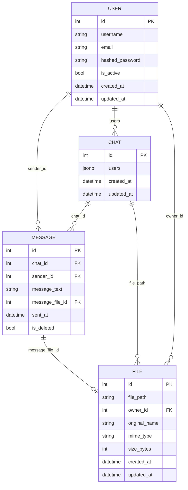

# Архитектура ITMessage

> Все эндпоинты, слои, данные и проблемы.
> Цвета: ✅ работает | 🟢 косметика (отложено) | 🟡 недоработка | 🔴 баг/риск | ⚫ мёртвый код

---

> ✅ Исправлено (B2): при потере соединения сообщения, уже отрисованные из стора,
> больше не пропадают. `activeChat`-подписка рендерит стор сразу и не очищает
> контейнер до сетевого ответа; обновление приходит через `messages:replaced`
> только при успехе запроса.
>
> ✅ Исправлено (B3): в `core/api.js` в обработчике 401 использовалась
> неопределённая переменная `url` (ReferenceError) — авто-refresh был сломан.
> Заменено на `original.url`.

## 1. Архитектура системы

```mermaid
graph LR
    subgraph USERS["Действия пользователя"]
        LOGIN[Вход]
        SEND[Отправка]
        SEARCH[Поиск]
        DELETE[Удаление]
    end

    subgraph ROUTES["Routes"]
        AUTH_R[auth.py<br/>✅ бизнес в сервисе]
        USERS_R[users.py<br/>✅ через UserManager]
        CHATS_R[chats.py<br/>✅ через ChatManager]
        MSG_R[messages.py<br/>✅ через MessageManager]
        FILE_R[files.py<br/>✅ через FileManager]
        PAGES_R[pages.py<br/>✅]
    end

    subgraph SERVICES["Services"]
        AMGR[AuthManager<br/>✅ токены/сессия/verify]
        UMGR[UserManager<br/>✅ весь UserDAO]
        CMGR[ChatManager<br/>✅ create/get/by_user/delete]
        MMGR[MessageManager<br/>✅ create/get_chat_messages/<br/>delete/build_response]
        FMGR[FileManager<br/>✅]
        WSMGR[WebSocketManager<br/>🟢 except Exception (M7)]
    end

    subgraph DAO["DAO / PostgreSQL"]
        UDAO[UserDAO<br/>✅]
        CDAO[ChatDAO<br/>✅]
        MDAO[MessageDAO<br/>✅ window fn +<br/>join-запросы chat/message]
        FDAO[FileDAO<br/>✅ find_by_ids]
    end

    subgraph WS["WebSocket"]
        WS_EP[ws.py<br/>✅]
        WSP[push: new_chat<br/>✅]
        WSPM[push: new_message<br/>✅ неактивный: инвалидация кэша]
        WSNR[✅ reconnect +<br/>индикатор статуса]
    end

    subgraph FRONT["Frontend (ES-модули, без сборки)"]
        direction TB
        APP[app.js<br/>✅ bootstrap: юзер/сокет/подписки]
        subgraph CORE["core/"]
            STORE[store.js<br/>✅ нормализация + события]
            HANDLER[wsHandler.js<br/>✅ optimistic confirm]
            WS_C[socket.js<br/>✅ reconnect backoff]
            API_C[api.js<br/>✅ refresh-интерсептор]
        end
        subgraph FEAT["features/"]
            F_CHAT[chats.js<br/>✅ список/создание/удаление]
            F_MSG[messages.js<br/>✅ lazy loading]
            F_SEND[send.js<br/>✅ отправка + paste]
            F_SEARCH[search.js<br/>✅ debounce]
        end
        subgraph UIM["ui/"]
            RENDER[messageView.js<br/>✅ createMessageEl — один источник разметки]
            IMG[imageLoader.js<br/>✅ lazy images]
            WSST[wsStatus.js]
            LB[lightbox.js]
        end
    end

    LOGIN --> AUTH_R
    SEND --> MSG_R
    SEARCH --> USERS_R
    DELETE --> MSG_R

    AUTH_R --> AMGR
    USERS_R --> UMGR
    CHATS_R --> CMGR
    MSG_R --> MMGR
    FILE_R --> FMGR

    AMGR --> UMGR
    UMGR --> UDAO
    CMGR --> CDAO
    MMGR --> MDAO
    MMGR --> FDAO
    FMGR --> FDAO

    MSG_R --> WSMGR
    WSMGR --> WSP
    WSMGR --> WSPM

    WS_EP --> WSMGR
    WS_EP --> UMGR
    WS_EP --> WSNR

    WSP --> HANDLER
    WSPM --> HANDLER
    HANDLER --> STORE
    STORE --> APP
    APP --> RENDER
    APP --> F_CHAT & F_SEND & F_SEARCH
    F_SEND --> STORE
    F_CHAT --> STORE
    F_MSG --> STORE
    RENDER --> IMG
```

## 2. REST API — все эндпоинты

```mermaid
graph LR
    subgraph AUTH["Auth"]
        R1[POST /api/auth/register<br/>✅ 201<br/>UserResponse]
        R2[POST /api/auth/login<br/>✅ 200<br/>TokenResponse]
        R3[POST /api/auth/logout<br/>✅ 200]
        R4[POST /api/auth/refresh<br/>✅ 200<br/>TokenResponse]
    end

    subgraph USERS["Users"]
        U1[GET /api/users/me<br/>✅ 200<br/>UserResponse]
        U2[GET /api/users/search<br/>✅ 200<br/>UserResponse array]
        U3[GET /api/users/id<br/>✅ 200<br/>UserResponse]
    end

    subgraph CHATS["Chats"]
        C1[GET /api/chats<br/>✅ 200<br/>ChatResponse array<br/>window fn]
        C2[GET /api/chats/direct/id<br/>✅ 200<br/>ChatResponse]
        C3[DELETE /api/chats/id<br/>✅ 204]
    end

    subgraph MESSAGES["Messages"]
        M1[GET /api/messages/id<br/>✅ 200<br/>1 запрос: chat + messages (join)]
        M2[POST /api/messages/id<br/>✅ 201<br/>MessageManager.create → MessageInDb]
        M3[DELETE /api/messages/id<br/>✅ 204<br/>1 запрос: msg + chat (join)]
    end

    subgraph FILES["Files"]
        F1[GET /api/files/id<br/>✅ 200<br/>image/file<br/>Pillow resize]
    end

    subgraph PAGES["Pages"]
        P1[GET /<br/>✅ Redirect]
        P2[GET /auth/register<br/>✅ HTML]
        P3[GET /auth/login<br/>✅ HTML]
        P4[GET /messages<br/>✅ HTML]
    end
```

## 3. WebSocket события

```mermaid
graph LR
    subgraph PUSH["Сервер → Клиент"]
        WS1[WS-01: new_chat<br/>✅ при создании чата<br/>ChatInDb]
        WS2[WS-02: new_message<br/>✅ активный чат<br/>MessageResponse]
        WS2B[WS-02b: new_message<br/>✅ неактивный чат<br/>last_message + инвалидация кэша]
        Note[✅ W8: new_message шлётся<br/>ВСЕМ участникам (включая<br/>отправителя), payload с client_id]
    end

    subgraph CLIENT["Клиент"]
        H[core/wsHandler.js<br/>✅ dispatch по type]
        S[core/store.js confirmMessage<br/>✅ optimistic → подтверждено]
        R[ui/messageView.js<br/>appendMessage / updateMessageInDom<br/>✅ гранулярно]
        U[core/store.js invalidateMessages<br/>✅ неактивный чат]
    end

    WS1 --> H
    WS2 --> H
    WS2B --> H
    H --> S
    S --> R
    WS2B --> U
```

## 4. Модель данных



## 5. Сводка проблем

```mermaid
graph LR
    subgraph CRIT["🔴 Критические (0)"]
        AllC[Все критические проблемы закрыты<br/>C1 ✅ нарушение слоёв → сервисы<br/>C2 ✅ uploads вне STATIC_DIR<br/>C3 ✅ model_validate(None) → is None<br/>C4 ✅ Unit of Work — commit только на write<br/>C5 ✅ get_redis — double-checked locking]
    end

    subgraph WARN["🟡 Недоработки (0)"]
        AllW[Все недоработки закрыты<br/>W2 ✅ chat+messages 1 запросом<br/>W3 ✅ message+chat 1 запросом<br/>W7 ✅ set_cookie → _auth_response<br/>W8 ✅ WS шлёт new_message отправителю<br/>W9 ✅ confirm по client_id, не по text<br/>W10 ✅ loaded-флаг + нормализация ключей]
    end

    subgraph BUGS["🐛 Баги (0)"]
        AllB[Все баги закрыты<br/>B1 ✅ optimistic message_file_id=-1<br/>+ updateMessageInDom пересоздаёт элемент<br/>при приходе файла в подтверждении<br/>B2 ✅ activeChat рендерит стор сразу,<br/>не очищает контейнер до сетевого ответа<br/>B3 ✅ core/api.js: url → original.url<br/>в обработчике 401 (был ReferenceError)]
    end

    subgraph MINOR["🟢 Косметика (9) — отложено"]
        M1[camelCase vs<br/>snake_case]
        M4[CORS origins<br/>захардкожены]
        M5[IMAGE_LOAD_TIMEOUT<br/>IMAGE_PLACEHOLDER<br/>захардкожены]
        M6[find_all без order_by<br/>→ неопределённый порядок]
        M7[except Exception<br/>в ws.py, files.py,<br/>utils/files.py,<br/>services/files.py]
        M8[Depends() внутри<br/>static method AuthManager]
        M9[notify_offline:<br/>2 DB + N WS<br/>запросов]
        M10[константы<br/>разбросаны]
        M11[isAuthRoute<br/>проверка по строке URL]
    end

    subgraph DEAD["⚫ Мёртвый код (0)"]
        AllD[Мёртвый код отсутствует<br/>MessageDAO.list_messages ✅ удалён]
    end
```

### Критические (подробно)

> Все критические проблемы закрыты (C1–C5). См. §7 `FIXED_BE`.

### Косметика (подробно) — отложено до следующего патча

> Все пункты помечены в коде как `# TODO: [SMELL]/[CONFIG]/[DUP]/[PERF]`
> со ссылкой на этот раздел. Функционально не критичны, поведение корректно.

| ID | Файл | Проблема |
|----|------|----------|
| M1 | `schemas/*`, `dao/*` | camelCase на фронте vs snake_case в API — нет явного маппинга |
| M4 | `main.py` | `allow_origins=[...]` захардкожен — вынести в `settings.ALLOWED_ORIGINS` |
| M5 | `ui/imageLoader.js`, `ui/messageView.js` | `IMAGE_LOAD_TIMEOUT`, `IMAGE_PLACEHOLDER` — захардкожены |
| M6 | `dao/base.py` | `find_all` без `order_by` → неопределённый порядок |
| M7 | `routes/ws.py`, `services/files.py`, `services/websocket_manager.py`, `utils/files.py` | `except Exception` вместо конкретных типов |
| M8 | `services/auth.py` | `Depends()` внутри `@staticmethod` — работает, но анти-паттерн |
| M9 | `services/presence.py` | `notify_offline` = 2 DB-запроса + commit + N WS sends |
| M10 | `core/constants.js`, `ui/imageLoader.js` | Константы разбросаны по файлам |
| M11 | `core/api.js` | `isAuthRoute` — проверка по строке URL |
| DUP1 | `schemas/user.py` | `trim` дублируется на уровне схемы и DAO |
| DUP2 | `services/chats.py` | `_build_chat_response` — дублирование сборки last_message |

### TODO в коде (по файлам) — отложенная косметика

| Файл | Что |
|------|-----|
| `dao/base.py` | find_all без order_by (M6) |
| `main.py` | CORS origins захардкожены (M4) |
| `routes/ws.py` | except Exception (M7) |
| `services/auth.py` | Depends в static method (M8) |
| `services/chats.py` | дублирование _build_chat_response (DUP2) |
| `services/files.py` | except Exception (M7) |
| `services/presence.py` | 2DB + N WS (M9) |
| `services/websocket_manager.py` | except Exception (M7) |
| `utils/files.py` | except Exception (M7) |
| `schemas/user.py` | trim дублируется (DUP1) |
| `core/api.js` | isAuthRoute по строке (M11) |
| `core/constants.js` | константы разбросаны (M10) |
| `ui/imageLoader.js` | IMAGE_LOAD_TIMEOUT захардкожен (M5) |
| `ui/messageView.js` | IMAGE_PLACEHOLDER захардкожен (M5) |

## 6. Ошибки типов (проверка типов / pyright)

> `routes/messages.py` (send_message). Все 10 ошибок закрыты.
> Фиксы: `chat_id_int` вместо мутации `chat_id: str`; `ChatManager.create → ChatInDb`
> + `model_dump(mode='json')` вместо `to_dict()`; `MessageManager.create → MessageInDb`
> вместо прямого `MessageDAO.add`; `file_id: int | None` в `MessageManager.create`.

```mermaid
graph LR
    subgraph ERRS["Ошибки (routes/messages.py)"]
        E1["✅ L76→80: chat_id_int = chat.id<br/>int в int-переменную"]
        E2["✅ L85→97: chat_id_int = int(chat_id)<br/>int в int-переменную"]
        E3["✅ L92→104: chat_id_int:int<br/>в get(chat_id:int)"]
        E4["✅ L118→130: save_file(chat_id_int:int)"]
        E5["✅ L126→138: FileManager.create(chat_id_int:int)"]
        E6["✅ L81→91: created_chat.model_dump(mode='json')<br/>вместо to_dict()"]
        E7["✅ chat только ChatResponse|None<br/>created_chat — отдельная переменная"]
        E8["✅ L141: file_in_db.id<br/>закрыто (create → FileInDb)"]
        E9["✅ L146→148: MessageManager.create<br/>→ MessageInDb"]
        E10["✅ file_id: int | None<br/>инициализирован до if file"]
    end
```



### Детализация и история фикса

| Строка (было → стало) | Сообщение | Корень | Статус | Как исправлено |
|------------------------|-----------|--------|--------|----------------|
| 76 → 80 | int → str (`chat_id = chat.id`) | `chat_id: str` | ✅ | `chat_id_int: int = created_chat.id` |
| 85 → 97 | int → str (`chat_id = int(chat_id)`) | `chat_id: str` | ✅ | `chat_id_int = int(chat_id)` |
| 92 → 104 | `chat_id: str` в `get(chat_id: int)` | `chat_id: str` | ✅ | `ChatManager.get(chat_id=chat_id_int)` |
| 118 → 130 | `save_file(chat_id: str)`, ожидался int | `chat_id: str` | ✅ | `save_file(chat_id_int, ...)` |
| 126 → 138 | `FileManager.create(chat_id: str)`, ожидался int | `chat_id: str` | ✅ | `FileManager.create(chat_id=chat_id_int, ...)` |
| 81 → 91 | `ChatInDb` не имеет `to_dict()` | `ChatManager.create → ChatInDb` | ✅ | `created_chat.model_dump(mode='json')` |
| 92 | `ChatResponse\|None` в переменную `ChatInDb` | смешение `create`/`get` в `chat` | ✅ | `created_chat` (ChatInDb) и `chat` (ChatResponse) — разные переменные |
| 141 | `int` не имел `id` (`file_in_db.id`) | `FileManager.create → int` | ✅ | `FileManager.create → FileInDb` |
| 146 → 148 | `Message` (ORM) вместо `MessageInDb` | `MessageDAO.add → Message` | ✅ | `MessageManager.create → MessageInDb` |
| 141 | `file_in_db` не связана при `file=None` | `file_id = None` мёртв, `file_in_db` только в `if file:` | ✅ | `file_id: int \| None = None` инициализирован до `if file` |

---

## 7. Исправлено в этой сессии (для актуальности графов)

```mermaid
graph LR
    subgraph FIXED_FE["✅ Frontend — состояние (store.js)"]
        FF1[Централизованный store.js<br/>нормализация: chats.byId/order,<br/>messages.byId по чатам, peerStatuses]
        FF2[Lazy loading сообщений<br/>1 загрузка с сервера + WS<br/>isLoaded / invalidateMessages]
        FF3[Optimistic updates<br/>addOptimisticMessage sended:false<br/>confirmMessage sended:true + real id]
        FF4[Гранулярные события<br/>messages:replaced / message:new /<br/>message:update — без полной перерисовки]
        FF5[WS неактивный чат<br/>инвалидирует кэш, история<br/>не теряется при открытии]
        FF6[temp-чат → реальный id<br/>store.replaceTempChat (чат+сообщения+DOM)]
        FF7[notify с payload +<br/>функция отписки у subscribe]
        FF8[Структура: core / features / ui + app.js<br/>createMessageEl — один источник разметки<br/>убраны дубли render + getFileIcon, state.js удалён]
        FF9[B2/B3: activeChat рендерит стор сразу<br/>(нет мигания/потери при offline);<br/>api.js 401: url → original.url]
    end

    subgraph FIXED_BE["✅ Backend — состояние"]
        FB0[C2: uploads вынесены в BASE_DIR/uploads,<br/>StaticFiles больше не отдаёт их публично,<br/>docker-compose: uploads_data volume]
        FB0b[C3: ChatManager.get — проверка is None<br/>до model_validate, безопасный return None<br/>вместо 500 (MessageManager.get удалён<br/>при рефакторинге — его роль у get_chat_messages)]
        FB0c[C4: Unit of Work — commit убран из get_session,<br/>явный session.commit() в write-эндпоинтах<br/>(register, delete_chat, send_message, delete_message),<br/>GET-запросы без commit]
        FB0d[W11: CSRF Double Submit Cookie —<br/>кука csrftoken + заголовок X-CSRF-Token,<br/>require_csrf на logout/refresh/send/delete]
        FB0e[C5: get_redis — double-checked locking<br/>с asyncio.Lock: один победитель создаёт<br/>ConnectionPool, остальные ждут, быстрая<br/>проверка без блокировки]
        FB0f[C1: Нарушение слоёв устранено:<br/>MessageManager.soft_delete вместо<br/>MessageDAO.soft_delete_message в роуте,<br/>FileManager.get вместо FileDAO в роуте]
        FB0g[temp-чат: peer_id в FormData вместо<br/>chat_id.split('-'), store.replaceTempChat,<br/>без хрупкого парсинга строк]
        FB0h[W2: MessageManager.get_chat_messages —<br/>чат+сообщения одним запросом<br/>(MessageDAO.find_by_chat_with_chat),<br/>батч-резолв файлов — нет N+1]
        FB0i[W3: MessageManager.delete —<br/>сообщение+участники чата одним запросом<br/>(MessageDAO.find_with_chat_users)]
        FB0j[Мёртвый код: MessageDAO.list_messages<br/>удалён (не вызывался)]
        FB0k[W7: routes/auth.py — хелпер _auth_response,<br/>устраняет дублирование set_cookie<br/>в login и refresh]
        FB0l[W8: send_message шлёт new_message<br/>ВСЕМ участникам (включая отправителя),<br/>payload содержит client_id]
        FB0m[W9: optimistic confirm по client_id<br/>(не по тексту) — store.confirmMessage,<br/>send.js генерирует crypto.randomUUID]
        FB0n[W10: нормализация ключей Map<br/>(_normalizeChatId) + флаг loaded<br/>вместо hasMessages(size>0)]
        FB0o[B1: optimistic message_file_id=-1 +<br/>updateMessageInDom пересоздаёт элемент,<br/>если в подтверждении пришёл файл]
        FB0p[dao/base.py: no-any-return закрыты<br/>через typing.cast — mypy 0 ошибок]
        FB1[routes/auth.py register:<br/>убран мёртвый except IntegrityError<br/>сервис уже конвертирует в ConflictError]
        FB2[UserManager: model_validate<br/>единообразие, get_active_user<br/>→ get_active]
        FB3[get_by_login → UserInDB or None<br/>без утечки NotFound наружу]
        FB4[send_message: new_chat<br/>шлётся и отправителю]
        FB5[ре-экспорт через __init__.py<br/>app.dao / app.schemas /<br/>app.services / app.utils]
        FB6[Логгер: info temp-chat убран<br/>дубль ChatManager; login<br/>success/fail → сервис; Pillow-рендер<br/>+ лог → utils; мёртвый logger<br/>chats.py удалён]
        FB7[W6: login/logout/refresh<br/>→ AuthManager.create_session /<br/>revoke_session / rotate_session;<br/>_generate_tokens c AppError;<br/>+ фикс: сессия неактивного<br/>юзера теперь отзывается при refresh]
    end
```

### Структура фронтенда

ES-модули без сборщика, подключаются одним `<script type="module">` в шаблоне.
Слои: `core` (инфраструктура) → `features` (доменные сценарии) → `ui` (отрисовка),
`app.js` — только композиция.

```
static/js/
├── app.js                 bootstrap: юзер → сокет → подписки на store → UI-модули
├── utils.js               форматтеры времени / last seen / иконки файлов
├── core/
│   ├── api.js             axios + refresh-интерсептор (очередь на время refresh)
│   ├── store.js           нормализованный стор + subscribe/notify с payload
│   ├── socket.js          WebSocket: exponential backoff, ping/pong, close-коды
│   ├── constants.js       константы WS
│   └── wsHandler.js       WS-события → мутации стора (без обращений к DOM)
├── features/
│   ├── auth.js            getCurrentUser / logout
│   ├── chats.js           список чатов, статусы собеседников, create/delete
│   ├── messages.js        loadChatMessages (lazy loading в стор)
│   ├── send.js            оптимистичная отправка, Enter, paste файла, лок отправки
│   ├── search.js          поиск пользователей (debounce)
│   ├── login.js           форма входа (чистый fetch, минуя api.js)
│   └── register.js        форма регистрации
└── ui/
    ├── messageView.js     createMessageEl — единственный источник разметки сообщения
    ├── imageLoader.js     IntersectionObserver + оптимизация размера/качества
    ├── wsStatus.js        индикатор статуса соединения
    ├── lightbox.js        просмотр изображения в полном размере
    └── badge.js           pet-бейдж
```

Правило зависимостей: `ui` и `features` не импортируют друг друга напрямую
(кроме `messageView → imageLoader`), общий только `core`. Разметка сообщения
живёт в одном месте — раньше она была продублирована в полной перерисовке
списка и в добавлении одного сообщения.

> ✅ W8 (закрыто): сервер в `send_message` шлёт `new_message` **всем** участникам,
> включая отправителя, а payload содержит `client_id`. Отправитель подтверждает
> оптимистичное сообщение по `client_id` как из POST-ответа, так и из WS-события
> (`store.confirmMessage(msg, message.client_id)` идемпотентен — дубль не создаётся).

---

## Статус проекта

| Категория | Кол-во | Статус |
|-----------|--------|--------|
| ✅ Работает | 68 | — |
| 🟡 Недоработки | 0 | Все закрыты (W2/W3/W7/W8/W9/W10/W11) |
| 🔴 Критические | 0 | Все закрыты (C1–C5) |
| 🔴 Баги | 0 | Все закрыты (B1) |
| 🔴 Ошибки типов | 0 открыто / 13 закрыто | ✅ ruff + mypy чисто |
| 🟢 Косметика | 9 (+2 DUP) | Отложено до следующего патча (§5) |
| ⚫ Мёртвый код | 0 | — |
| **Всего** | **~99% готово** | Готово к коммиту v3.0 |
