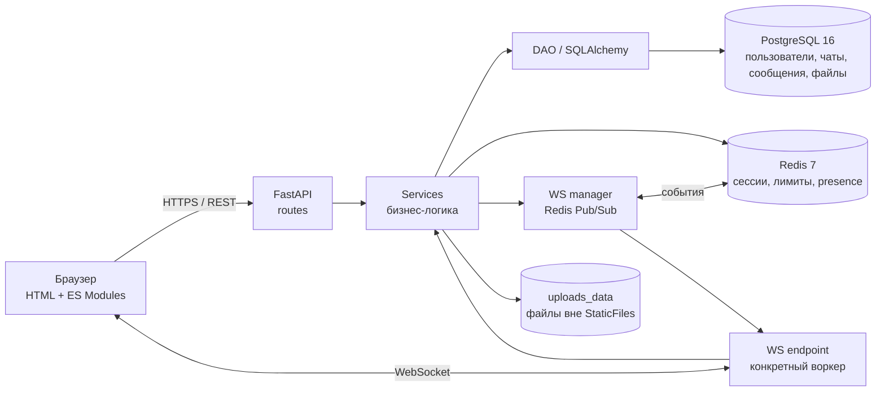
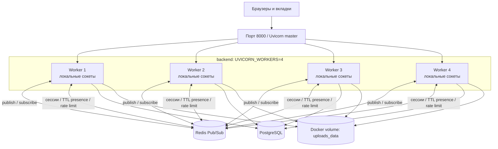
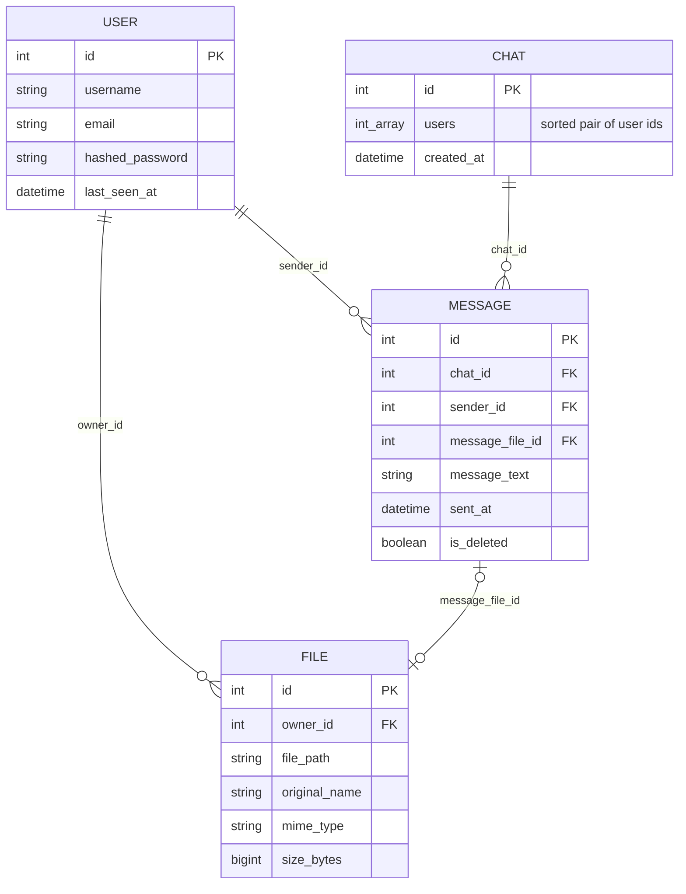
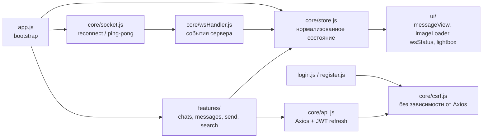

# Архитектура ITMessage

Актуальная архитектура после PR #13 (4 ноября 2026). История исправлений — в [CHANGELOG](CHANGELOG.md), оставшиеся задачи — в [TODO](TODO.md). Подробные последовательности — в [data_flow.md](data_flow.md).

## 1. Компоненты и границы ответственности

* `routes/` — HTTP и WebSocket, валидация и управление транзакциями.
* `services/` — авторизация, чаты, сообщения, файлы, глобальный presence и WS-маршрутизация.
* `dao/`, `models/` — доступ к данным, SQLAlchemy и PostgreSQL.
* `schemas/` — Pydantic DTO; `exceptions/` — типизированные ошибки.
* `core/`, `features/`, `ui/` — клиентское состояние, сценарии и отображение.
* `app/main.py` — lifespan: Redis, подписчик WebSocket, shutdown соединений и пула БД.

## 2. Production-топология: четыре воркера

Соединение WebSocket принадлежит одному воркеру, а события Redis получают все подписчики и доставляют **только своим локальным вкладкам адресатов**. `WebSocketManager` использует `asyncio.Lock` для локального реестра соединений; глобальный статус отслеживает Redis (`ZSET`, TTL 90 секунд, атомарные Lua-операции). Счётчики rate limit также хранятся в Redis.

При обрыве Pub/Sub подписчик повторяет подключение. Redis Pub/Sub **не хранит** события на время отсутствия подписчика, поэтому база PostgreSQL остаётся источником истины, а клиент обновляет чаты и историю после WS reconnect. Это восстановление состояния, не гарантия доставки каждого push-события.

## 3. Реляционная модель

**Важно:** связь `USER ↔ CHAT` логическая, через `chats.users: ARRAY(Integer)`, а не внешний ключ или `jsonb`. Для прямого чата IDs сортируются; уникальный B-tree индекс по массиву не допускает два одинаковых канонических набора. Прямое сообщение и файл связаны опционально. Удаление сообщения — soft-delete, удаление чата удаляет зависимые записи; физическая очистка файлов выполняется после фиксации транзакции (с оговоркой об аварии между commit и cleanup).

## 4. Клиентские модули и события

Отправитель генерирует `client_id`, добавляет optimistic-сообщение в store, а затем подтверждает его по HTTP-ответу или `new_message` WebSocket. Вход и регистрация не зависят от инициализации Axios.

## 5. API

| Группа | Маршруты |
| --- | --- |
| Auth | `POST /api/auth/register`, `login`, `refresh`, `logout` |
| Users | `GET /api/users/me`, `search?query=`, `{user_id}` |
| Chats | `GET /api/chats`, `/direct/{target_id}`; `DELETE /api/chats/{chat_id}` |
| Messages | `GET /api/messages/{chat_id}`, `POST /api/messages/{chat_id}`, `DELETE /api/messages/{message_id}` |
| Files | `GET /api/files/{file_id}` (включая обработку изображений) |
| WebSocket | `/api/ws/{user_id}` с Origin и cookie-авторизацией |

HTTP-роуты доступны через FastAPI OpenAPI (`/docs`); cookies с JWT и CSRF используются для записи. WebSocket до соединения проверяет точное значение `Origin` по `ALLOWED_ORIGINS`.

## 6. Проверки и известные ограничения

Единый [workflow CI](../.github/workflows/ci.yml) содержит независимые jobs для Python (Ruff, mypy, unit, PostgreSQL миграции, Redis интеграция, HTTP smoke), Node.js и Docker Compose с четырьмя воркерами. Подробнее: [ci.md](ci.md), [ws-multiworker.md](ws-multiworker.md).

Действующие ограничения: временная потеря Pub/Sub событий при сбое Redis; возможная перестановка событий online/offline при быстром reconnect (N19); отсутствие durable очереди для гарантированной очистки файлов после аварийного завершения процесса. Детали и решения — в [TODO.md](TODO.md).
