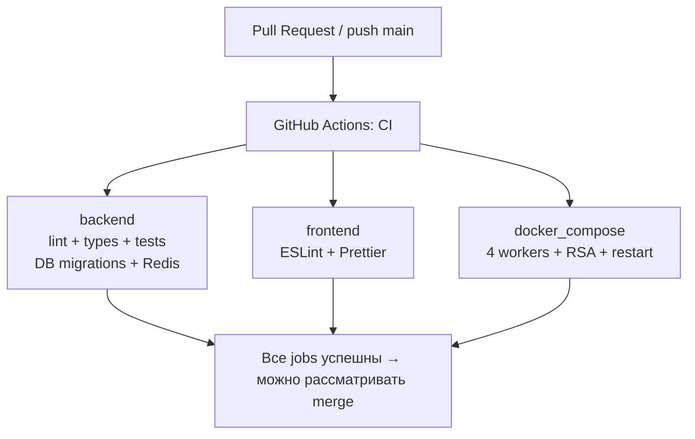

# CI и проверки качества

**Один workflow:** [`.github/workflows/ci.yml`](../.github/workflows/ci.yml). Он запускается на каждом pull request, push в `main` и вручную через GitHub Actions. Задания независимы, чтобы тяжёлый Docker smoke не блокировал быстрый lint.

| Job | Проверки | Внешние сервисы |
| --- | --- | --- |
| `backend` — Python 3.12 | `ruff check`, `ruff format --check`, mypy, unit, `alembic upgrade head`, Redis integration, HTTP smoke | PostgreSQL 16 + Redis 7 |
| `frontend` — Node 22 | ESLint, Prettier | Нет |
| `docker_compose` | Production Compose, 4 Uvicorn workers, runtime RSA, image secrets, HTTP smoke, рестарт | PostgreSQL + Redis + backend в Docker |



В `docker_compose` используются временные RSA-ключи и временная БД; на завершении volumes удаляются. `backend/tests/smoke_http.py` создаёт учётные записи и сообщения — **не запускайте его на production**. Smoke выполняется и в Python job, и через собранный Docker-образ, чтобы проверить разные пути запуска.

## Локальные проверки

Из корня репозитория:

```bash
python -m pip install -r backend/requirements-dev.txt
npm ci
cd backend
ruff check .
ruff format --check .
mypy --package app
python -m unittest discover -s tests -p 'test_*.py' -v
cd ..
npx --yes --package eslint@9.39.2 eslint backend/app/static/js
npx --yes --package prettier@3.6.2 prettier --check "backend/app/static/**/*.{js,css,html}"
```

Интеграционные Redis-тесты требуют **отдельного тестового Redis**; пример команды и предупреждения — в [ws-multiworker.md](ws-multiworker.md). Полный Compose-проверочный сценарий проще запускать через Actions: он создаёт и удаляет тестовую инфраструктуру.

## Правила принятия PR

1. Ruff lint **и** Ruff format должны пройти отдельно — исправление порядка импортов не гарантирует форматирование.
2. Успешно завершены **все три** jobs основного CI, включая Docker Compose.
3. PR синхронизирован с `main`, нет конфликтов и неожиданных файлов.
4. После ревью — **Squash and merge**, затем удалить ветку; `main` не переписывать.

Настройка branch protection производится в GitHub Settings → Branches / Rulesets. Обязательные checks: `Python 3.12 / lint, types, tests`, `Node 22 / ESLint, Prettier`, `Docker / 4 Uvicorn workers / HTTP`.

Правила сообщений коммитов и веток описаны в [CONTRIBUTING.md](../CONTRIBUTING.md). Локальные хуки — в [pre-commit.md](pre-commit.md); они не выполняются при прямых правках через GitHub API, поэтому CI обязателен.
