# Data Flow ITMessage

> Как данные текут через систему. Каждая диаграмма — отдельный флоу.

---

## 1. Авторизация (вход)

> `features/login.js` и `features/register.js` идут через чистый `fetch`, минуя `core/api.js` —
> чтобы не тянуть интерсептор refresh там, где пользователь ещё не авторизован. `core/api.js`
> подключается только после входа (GET /users/me).
>
> `sub` токена = session_id, user_id резолвится через Redis → сессии отзываемые.

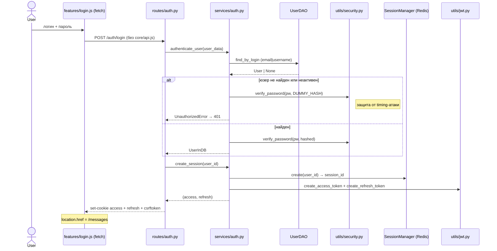

---

## 1b. Проверка текущей сессии (после входа)

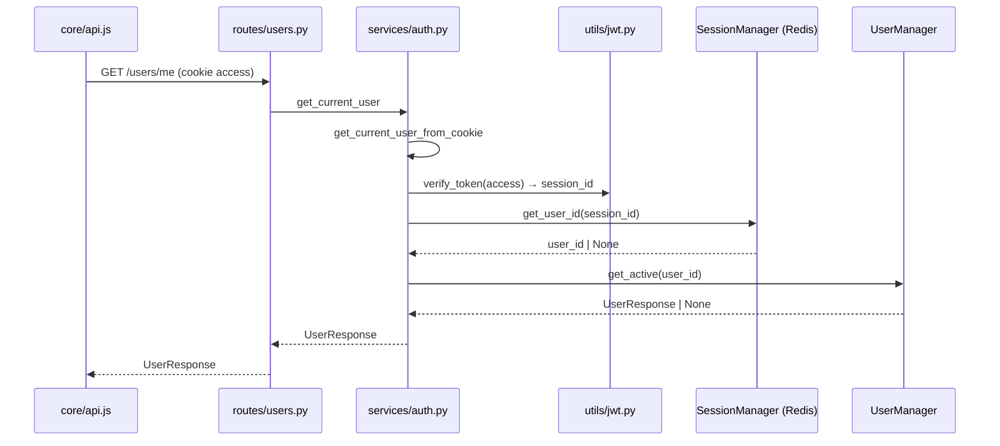

---

## 1c. Refresh токена (ротация сессии)

> ✅ Бизнес-логика в `AuthManager.rotate_session()` — роут только читает cookie
> и ставит новые. Ошибки токенов (JWTError/RedisError) → `AppError` в `_generate_tokens`.
> Фикс: при неактивном/удалённом пользователе старая сессия теперь отзывается.
> ✅ CSRF: POST /auth/refresh требует `X-CSRF-Token` header == кука `csrftoken`.

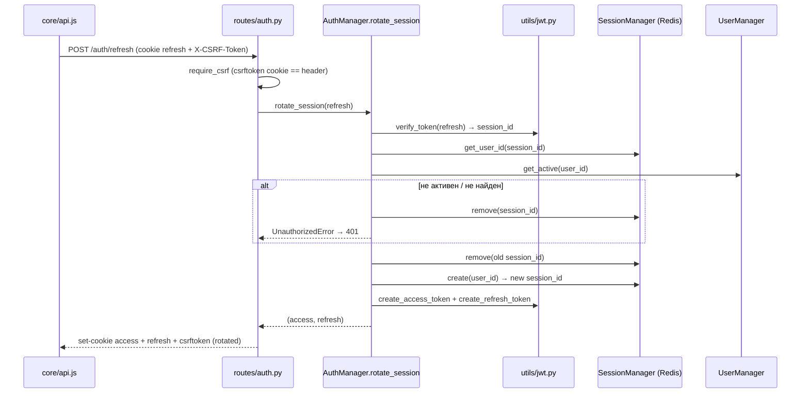

---

## 1d. Logout

> ✅ CSRF: POST /auth/logout требует `X-CSRF-Token` header == кука `csrftoken`.
> Отзывает сессию в Redis + чистит access/refresh/csrftoken куки.

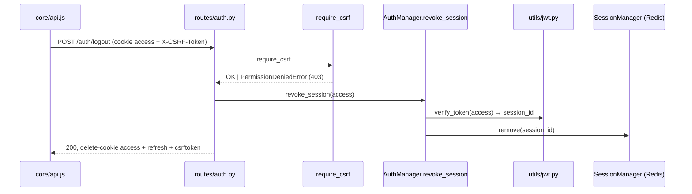

---

## 1e. Проблемы авторизации

```mermaid
graph LR
    subgraph WARN["🟢 Косметика (отложено, см. architecture.md §5)"]
        B4[trim дважды:<br/>схема + DAO (DUP1)]
        B5[Depends() внутри<br/>@staticmethod AuthManager (M8)]
    end

    subgraph OK["✅ Хорошо"]
        C1[authenticate_user<br/>в сервисе]
        C2[Timing-attack<br/>DUMMY_HASH]
        C3[Ротация сессий<br/>на refresh]
        C4[JWT sub =<br/>session_id]
        C5[UserResponse<br/>id возвращён]
        C6[лог auth.py<br/>user_data.login]
        C7[rotate_session /<br/>create_session /<br/>revoke_session<br/>в сервисе (W6)]
        C8[CSRF Double Submit<br/>cookie csrftoken +<br/>header X-CSRF-Token<br/>на logout/refresh/send/delete]
    end
```

---

## 2. Отправка сообщения

> ✅ Optimistic UI: клиент сразу кладёт сообщение в стор (`sended:false`, temp id)
> и рисует его. После успешного POST — `store.confirmMessage(response.data, clientId)`
> заменяет temp id на реальный и ставит `sended:true` (⏳ → ✓).
> Дубль `GET /messages` после отправки убран — список больше не перезагружается.
> ✅ CSRF: POST требует `X-CSRF-Token` == кука `csrftoken`.
> ✅ Unit of Work: create chat + create file + create message — 1 транзакция (`session.commit()`).
>
> ✅ W8: сервер шлёт `new_message` **всем** участникам, включая отправителя,
> а payload содержит `client_id`. `store.confirmMessage` идемпотентен: и POST-ответ,
> и WS-событие с одинаковым `client_id` приведут к одному подтверждению (без дублей).
> ✅ W9: матчинг оптимистичного сообщения — по `client_id` (uuid), не по тексту.

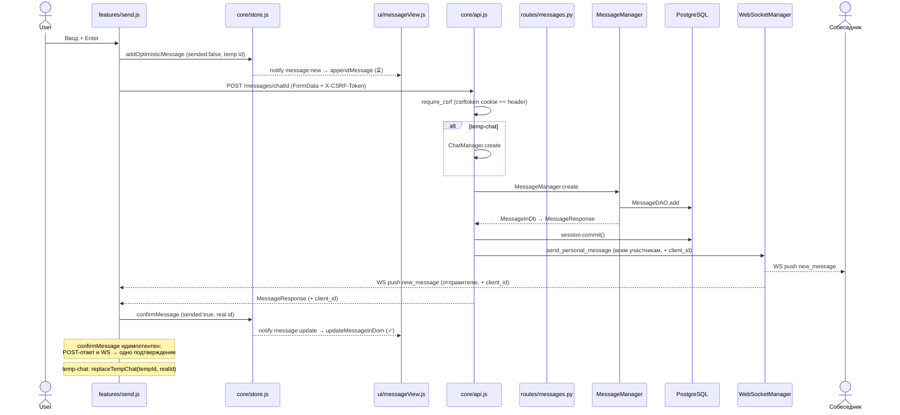

---

## 2b. Загрузка сообщений чата

> ✅ W2: чат и его сообщения — одним запросом
> (`MessageDAO.find_by_chat_with_chat`, outerjoin). Проверка доступа к чату
> делается по `chat.users` из того же запроса — без второго round-trip.
> ✅ Файлы сообщений подтягиваются батчем (`FileDAO.find_by_ids`) — нет N+1.

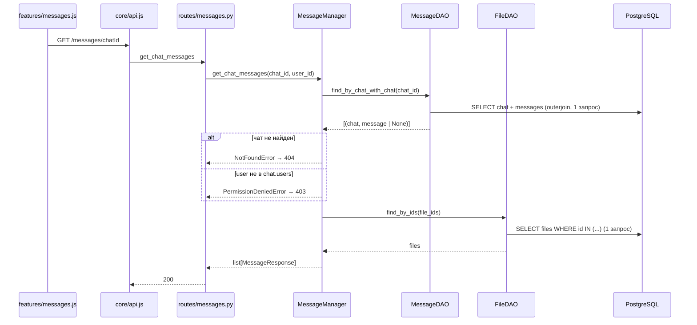

---

## 3. Realtime-получение сообщения

> ✅ Стор обновляется всегда: активный чат → `confirmMessage` (render одного
> сообщения), неактивный → `updateChatLastMessage` + `invalidateMessages`
> (история подтянется с сервера при открытии).
> ✅ W8: событие приходит и отправителю (payload с `client_id`) — подтверждение
> оптимистичного сообщения не зависит от POST-ответа.

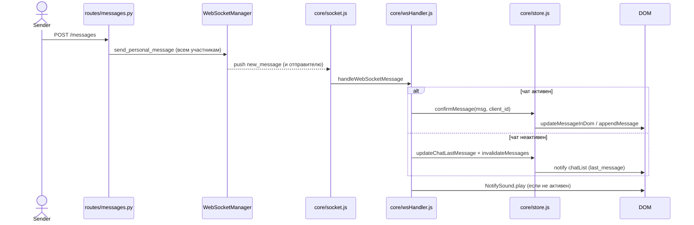

---

## 4. Создание temp-чата

> ✅ temp-чат использует `peer_id` в FormData вместо парсинга строки.
> `store.replaceTempChat(tempId, realId)` атомарно переносит чат, сообщения и DOM-узел.

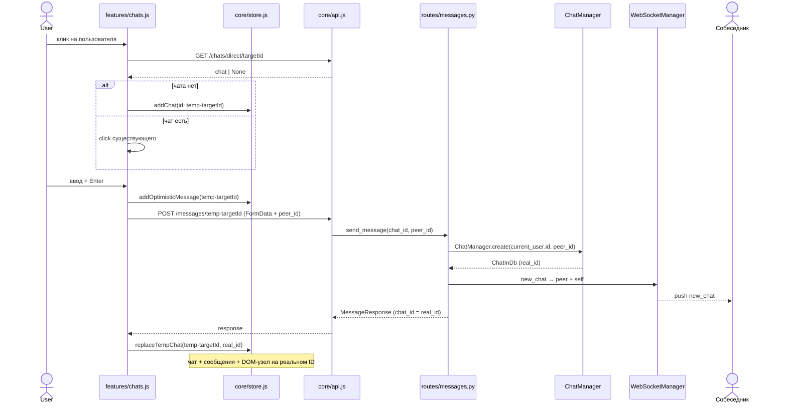

---

## 5. Удаление сообщения

> ✅ CSRF: DELETE требует `X-CSRF-Token` == кука `csrftoken`.
> ✅ W3: сообщение + участники чата — одним запросом
> (`MessageDAO.find_with_chat_users`, join). Проверки автора и членства — в Python.
> ✅ Unit of Work: `session.commit()` только после write-операции.

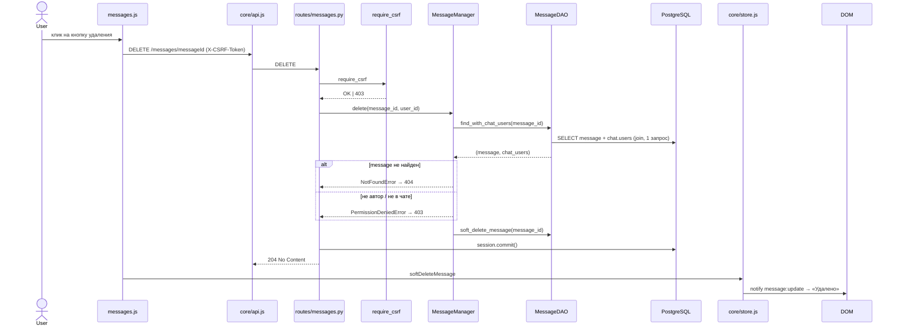

---

## 6. Обработка 401 (auto-refresh)

> ✅ B3 (исправлено): в обработчике 401 использовалась неопределённая переменная
> `url` (ReferenceError) — авто-refresh падал. Теперь проверка идёт по `original.url`.

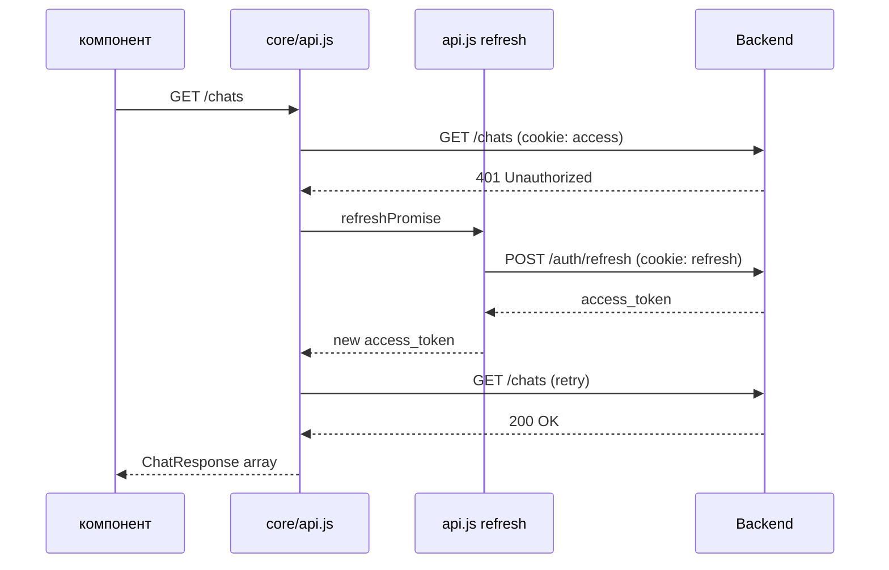

---

## 7. Жизненный цикл WebSocket

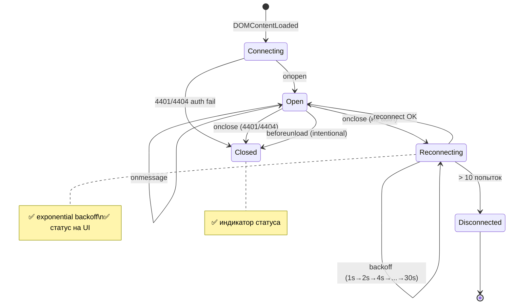

---

## 8. Состояния чатов

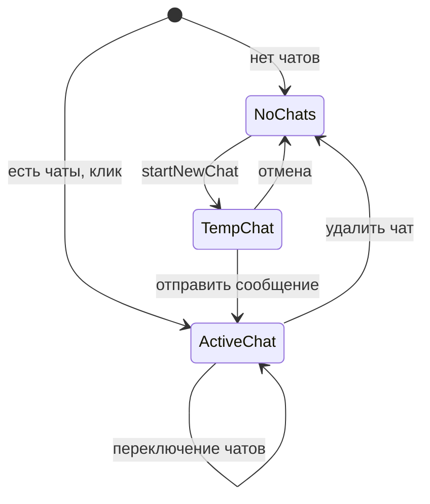

---

## 9. Состояние отправки (optimistic)

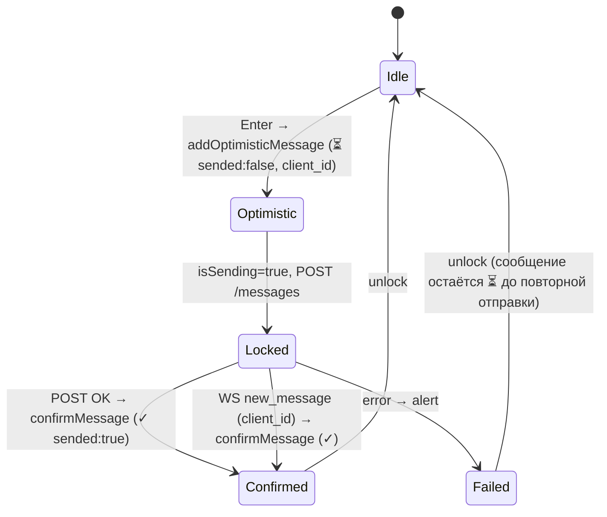

> ✅ W8/W9: подтверждение может прийти как из POST-ответа, так и из WS-события
> (сервер шлёт `new_message` и отправителю). `confirmMessage` идемпотентен по
> `client_id`/реальному id — двойное подтверждение не создаёт дубль.

---

## Сводка по флоу

| Флоу | Статус | Проблема |
|------|--------|----------|
| Авторизация (вход) | ✅ | — |
| Проверка сессии | ✅ | — |
| Refresh токена | ✅ | Бизнес-логика в AuthManager.rotate_session, CSRF |
| Logout | ✅ | CSRF Double Submit Cookie |
| Отправка | ✅ | Optimistic + confirm по client_id (POST/WS) + CSRF + Unit of Work |
| Загрузка сообщений | ✅ | W2: chat+messages одним запросом, файлы батчем (нет N+1) |
| Отправка — типы | ✅ | 10/10 несоотв. типов исправлены (см. architecture.md §6) |
| Realtime | ✅ | W8: событие и отправителю; активный: confirmMessage → render; неактивный: invalidate + chatList |
| Temp-чат | ✅ | peer_id в FormData, store.replaceTempChat, без split |
| Удаление сообщения | ✅ | W3: message+chat одним запросом, CSRF + Unit of Work |
| Auto-refresh | ✅ | B3: url → original.url (был ReferenceError) |
| WebSocket | ✅ | Reconnect + индикатор статуса |
| Загрузка файла | ✅ | Pillow-рендер и лог вынесены в utils.render_image_response |
| Хранение файлов | ✅ | uploads в `BASE_DIR/uploads`, вне STATIC_DIR |
| get_redis | ✅ | Double-checked locking с asyncio.Lock |
| session.commit | ✅ | Unit of Work — только на write-операциях |
| model_validate(None) | ✅ | `is None` до валидации |
| Нарушение слоёв | ✅ | Все DAO через сервисы (MessageManager/FileManager) |
| Состояния чатов | ✅ | — |
| Состояние отправки | ✅ | Optimistic (⏳→✓ через confirmMessage по client_id) |
| Открытие чата (offline) | ✅ | B2: рендер из стора сразу, без очистки до ответа сети |

## Принципы логирования

```
Route:   только HTTP-обвязка, логи почти не нужны
Service: все info/warning/error бизнес-событий
Access:  авто (uvicorn пишет сам: метод/путь/статус/время)
```

### Что перенести в сервисы

| Файл | Лог | Куда перенести | Статус |
|------|-----|----------------|--------|
| routes/auth.py | info регистрация | services/auth.py | ✅ в сервисе |
| routes/auth.py | except IntegrityError | — | ✅ убран (мёртвый, сервис кидает ConflictError) |
| routes/auth.py | login success/fail | services/auth.py | ✅ перенесено в authenticate_user |
| routes/auth.py | refresh/token errors | services/auth.py | ✅ rotate_session/_generate_tokens (B1 закрыто) |
| routes/messages.py | info temp-chat | ChatManager | ✅ убран (дубль ChatManager.create) |
| routes/messages.py | except Exception | AppError | ✅ все HTTPException → typed exceptions |
| routes/files.py | Pillow error | utils/files.render_image_response | ✅ перенесено в utils |

### Мёртвые импорты logger

- `routes/chats.py` — ✅ `get_logger`/`logger` удалены (был мёртвым)
- `routes/files.py` — ✅ `logger` удалён вместе с Pillow-логикой (ушла в utils)
- `routes/messages.py` — `logger` живой: fallback `except Exception` в `send_message`
- `services/*` — живой, бизнес-события
