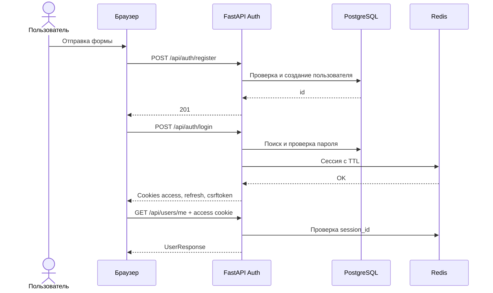
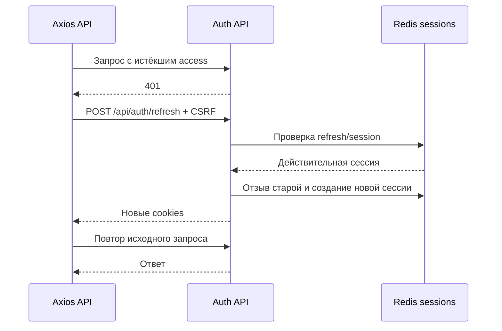
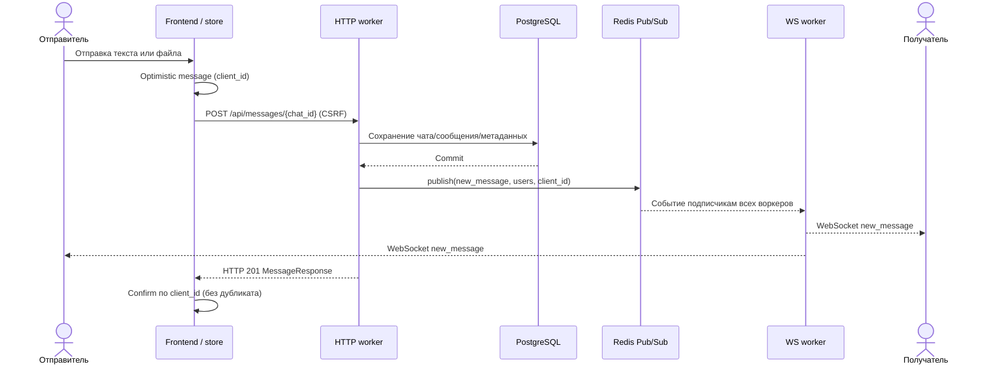
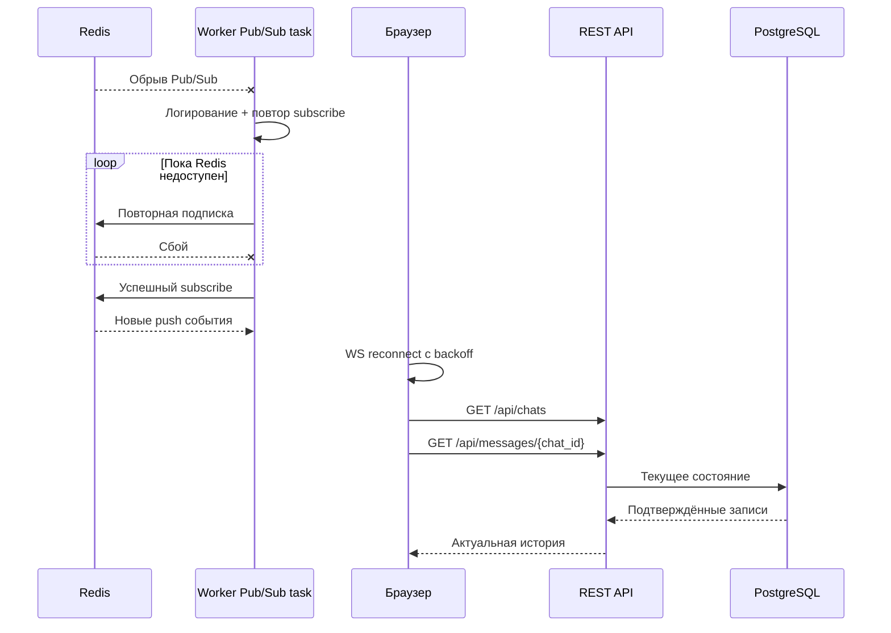
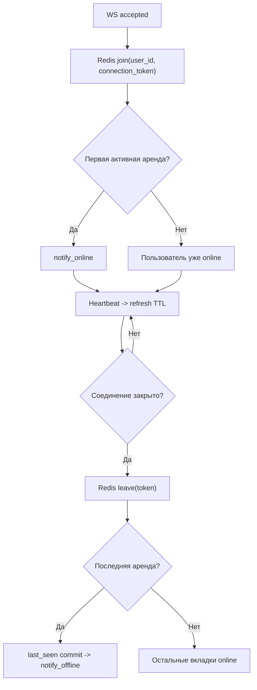
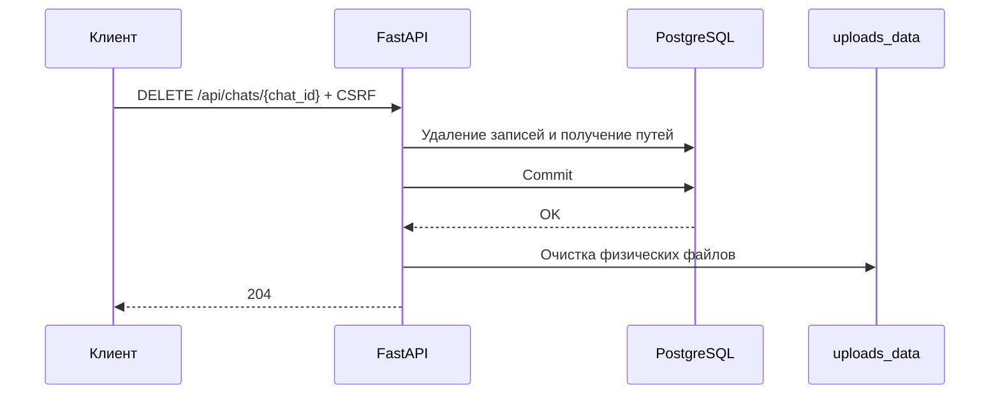

# Потоки данных ITMessage

Актуально после PR #13. Схема компонентов и модели данных — [architecture.md](architecture.md); проверка четырёх воркеров — [ws-multiworker.md](ws-multiworker.md).

## 1. Регистрация, вход и сессия

JWT подписывается RS256; access/refresh хранятся в HttpOnly cookies, `csrftoken` доступен JavaScript для заголовка `X-CSRF-Token`. Страницы входа и регистрации используют независимый `core/csrf.js`, без импорта Axios.

## 2. Ротация токена

В `core/api.js` параллельные запросы ожидают один выполняющийся refresh; повторный запрос инициируется только после получения новых cookies.

## 3. Отправка сообщения между четырьмя воркерами

Физические файлы записываются в `uploads_data` вне публичной статики. При новом диалоге фронтенд передаёт `peer_id` и временный chat-id; API создаёт канонический чат в транзакции. `new_chat` и `new_message` публикуются после успешного commit.

**Ограничение:** Redis Pub/Sub не является durable очередью. Если после commit Redis недоступен, сообщение остаётся в PostgreSQL, но push может потеряться. Сбой публикации не должен превращать успешный commit в ложную ошибку повторной отправки.

## 4. Отключение Redis и переподключение

В PR #13 обработаны ошибки повторной подписки Redis и очистки WS-подключений. Обработчик WS закрывает соединение с кодом 1012 при недоступности Redis в heartbeat, после чего клиент может восстановить соединение. События за время разрыва **не воспроизводятся из Pub/Sub**; история восстанавливается только по REST.

## 5. Онлайн-статус и несколько вкладок

Redis хранит отдельную аренду каждой вкладки в ZSET, индекс пользователей и TTL. При аварийной остановке воркера статус истечёт, но мгновенное push-уведомление по TTL не гарантировано. Быстрый reconnect может переупорядочить `presence_update` — открытая задача N19.

## 6. Удаление файлов и сообщения

Очистка файлов после commit предотвращает потерю содержимого при неудачной транзакции. Но при аварии между commit и удалением файла возможны осиротевшие файлы — нужна отдельная durable cleanup queue/outbox. Удаление сообщения — soft-delete без немедленного удаления всех связанных физических файлов.
